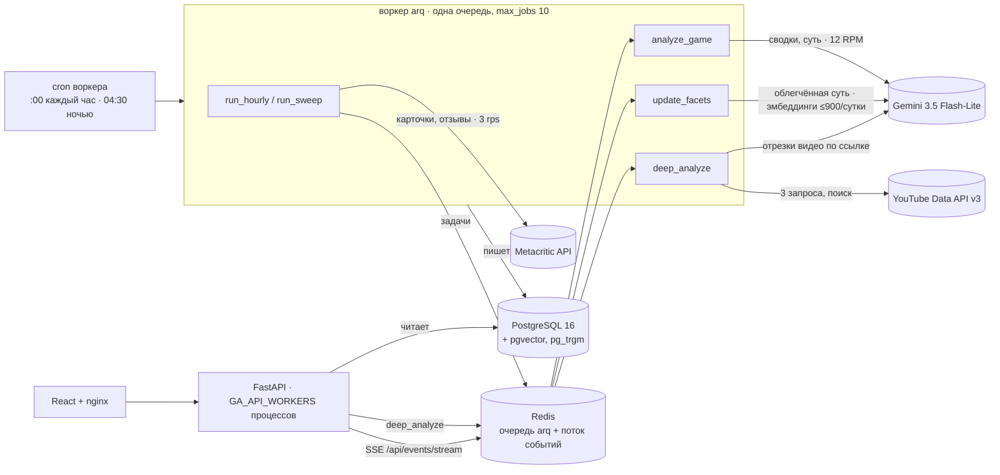
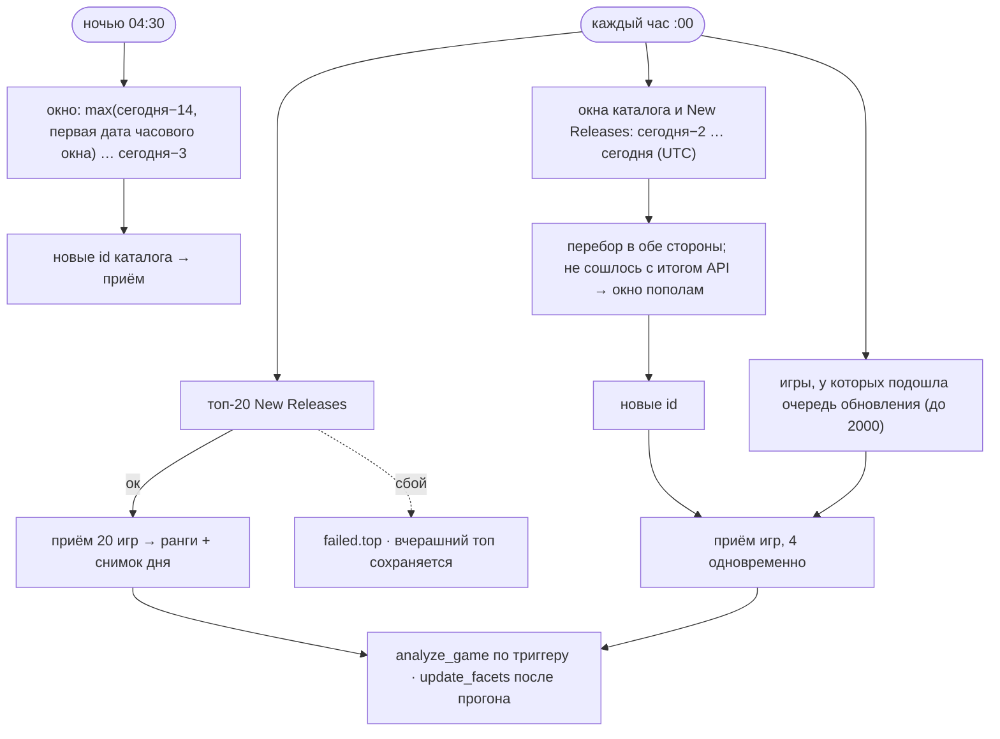
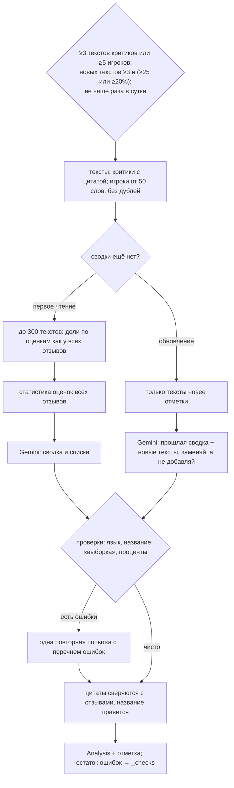
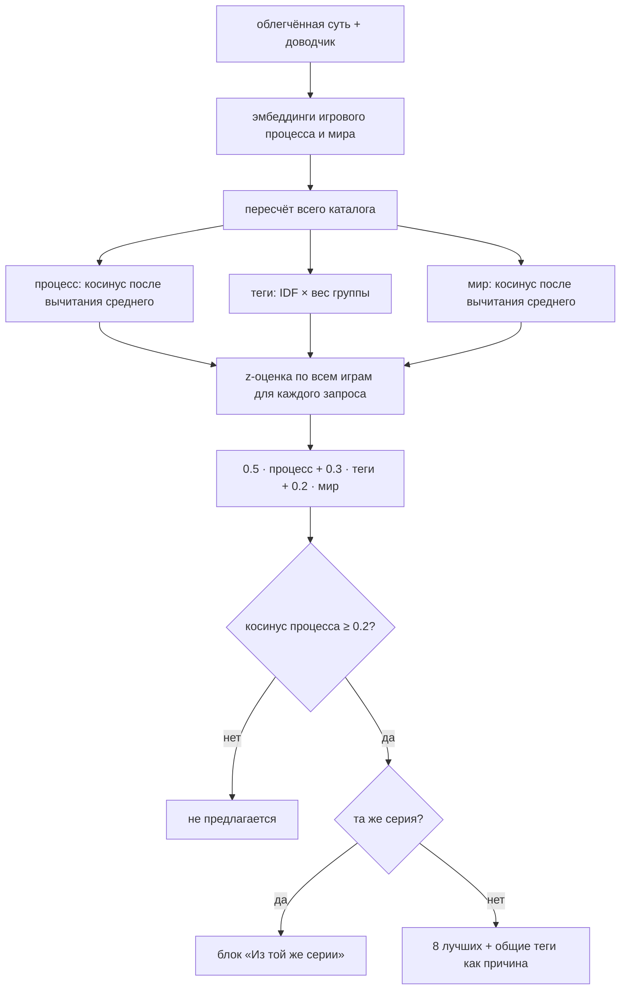
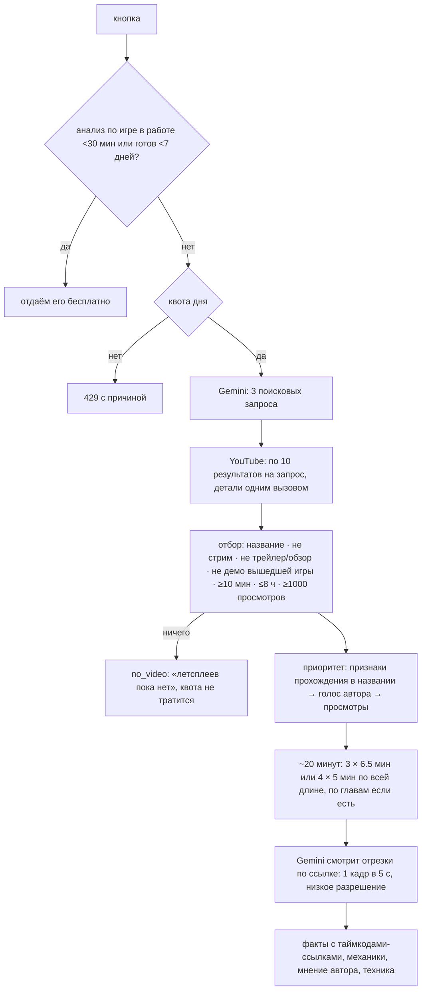

# GameAnalytics

Аналитика выходящих видеоигр по данным Metacritic. Сервис каждый час находит новые игры и следит за реакцией на
них. Модель Gemini сводит отзывы критиков и игроков в короткие разборы и описывает суть каждой игры. По сути
подбираются похожие игры. По кнопке «Deep analyze» модель смотрит отрезки популярного летсплея на YouTube и
выделяет факты, которых нет в описании магазина.

Состояние на 16.10.2026: MVP собран и проверен на стенде. Пройдены фаза 1 (намеренные поломки) и фаза 2
(проверка качества на готовых ответах). Следующий этап — деплой. Всё работает на бесплатных ключах Google.

---

## Содержание

1. [Быстрый старт](#быстрый-старт)
2. [Архитектура](#архитектура)
3. [Стек технологий](#стек-технологий)
4. [Внешние источники и их лимиты](#внешние-источники-и-их-лимиты)
5. [Механизмы](#механизмы)
   - [Часовой цикл и ночной проход](#часовой-цикл-и-ночной-проход)
   - [Приём одной игры](#приём-одной-игры)
   - [Уровни обновления](#уровни-обновления)
   - [Сводки отзывов](#сводки-отзывов)
   - [Суть игры](#суть-игры)
   - [Похожие игры](#похожие-игры)
   - [Deep analyze](#deep-analyze)
   - [Квоты бесплатного ключа](#квоты-бесплатного-ключа)
6. [Модель данных](#модель-данных)
7. [API](#api)
8. [Интерфейс](#интерфейс)
9. [Надёжность](#надёжность)
10. [Тестовый стенд](#тестовый-стенд)
11. [Качество и экономика](#качество-и-экономика)
12. [Известные проблемы и ограничения](#известные-проблемы-и-ограничения)
13. [Принятые решения](#принятые-решения)
14. [Что дальше](#что-дальше)
15. [Структура репозитория](#структура-репозитория)
16. [Настройки](#настройки)
17. [Документы и исследования](#документы-и-исследования)

---

## Быстрый старт

Нужны Docker, Python 3.12 и Node 22.

```bash
docker compose up -d postgres redis
```

```bash
cd backend && python3 -m venv .venv && .venv/bin/pip install -r requirements-dev.txt
```

Ключи кладутся в `backend/.env` (файл в `.gitignore`, образец — `backend/.env.example`). Для работы с моделью нужны
`GA_LLM_PROVIDER=gemini` и `GA_GEMINI_API_KEY` (Google AI Studio). Для Deep analyze ещё нужен
`GA_YOUTUBE_API_KEY`: YouTube Data API v3 бесплатен, без биллинга, ключ создаётся в том же проекте Google Cloud.

API на http://localhost:8000:

```bash
cd backend && .venv/bin/uvicorn app.api.main:app --reload
```

Воркер: часовой цикл, ночной проход, анализы:

```bash
cd backend && .venv/bin/arq app.pipeline.tasks.WorkerSettings
```

Интерфейс на http://localhost:5173:

```bash
cd frontend && npm install && npm run dev
```

Полный стек в Docker: интерфейс на http://localhost:8080, API на http://localhost:8000. Ключи берутся из
`backend/.env`, у всех сервисов стоит `restart: unless-stopped`.

```bash
docker compose up -d --build
```

Продакшен — один VPS на Ubuntu 24.04. Адрес лежит в `deploy/.host` в виде `user@server`; этот файл в git не попадает. Используются [deploy/compose.yml](deploy/compose.yml) и
[deploy/deploy.sh](deploy/deploy.sh). Вход на сервер только по SSH-ключу `~/.ssh/ga_deploy`, пароль не используется.
- **Порты.** Снаружи открыт только 80-й, у nginx; Postgres, Redis и API закрыты внутри.
- **Секреты.** Ключи и случайный пароль базы лежат в `/opt/gameanalytics/deploy/.env` с правами 600, в git их нет.
- **Время.** Протокол точного времени у провайдера закрыт, часы сервера держит htpdate по HTTPS.

Выкатить текущий коммит, посмотреть состояние, логи, сделать бэкап:

```bash
deploy/deploy.sh up
```

```bash
deploy/deploy.sh status
```

```bash
deploy/deploy.sh logs worker
```

```bash
deploy/deploy.sh backup
```

Локально воркер при этом не запускают: ключ Gemini общий.

Ручные команды:

```bash
cd backend && .venv/bin/python -m app.cli inline hourly
```

```bash
cd backend && .venv/bin/python -m app.cli analyze castlevania-belmonts-curse marvels-wolverine
```

Тесты. Интеграционные идут на настоящем Postgres стенда, без `GA_TEST_DATABASE_URL` они пропускаются:

```bash
cd backend && .venv/bin/pytest
```

```bash
cd backend && GA_TEST_DATABASE_URL=postgresql+asyncpg://ga:ga@localhost:5433/ga_test .venv/bin/pytest tests/integration
```

---

## Архитектура



Устройство сервиса:
- **Воркер делает всю работу,** API только читает базу и ставит задачи. Воркер один, на этом держится часть
  восстановления после сбоев (см. «Надёжность»).
- **Все внешние вызовы проходят через три слоя** в `app/core`:
  - **лента** (`tape.py`): в бою вызов идёт напрямую, на стенде ответы записываются и воспроизводятся;
  - **слой сбоев** (`faults.py`): только стенд, подставляет отказы внешних сервисов;
  - **часы** (`clock.py`): на стенде время можно заморозить.
- **Каждое действие пишет событие в поток Redis.** DevPanel получает эти события по SSE и рисует, какой узел
  сейчас работает и где ошибки.

---

## Стек технологий

| Слой | Технологии | Зачем |
|---|---|---|
| Backend | Python 3.12, FastAPI, Uvicorn, Pydantic Settings | API, настройки `GA_*` |
| Фоновая работа | arq (очередь задач на Redis), asyncio | часовой цикл, ночной проход, анализы, cron |
| Данные | PostgreSQL 16 (образ `pgvector/pgvector:pg16`), SQLAlchemy 2 async, asyncpg, pgvector, pg_trgm | игры, отзывы, анализы, векторы, поиск по названию |
| События | Redis 7 Streams, Server-Sent Events | DevPanel в реальном времени |
| HTTP | httpx (async, MockTransport в тестах) | Metacritic, YouTube |
| LLM | Google Gen AI SDK (`google-genai`), Gemini 3.5 Flash-Lite, thinking `minimal`, ответы по JSON Schema | сводки, суть, поисковые запросы, разбор видео |
| Эмбеддинги | `gemini-embedding-001`, 768 измерений, `SEMANTIC_SIMILARITY` | векторы игрового процесса и мира |
| Расчёты | NumPy | центрирование, IDF тегов, z-оценки, похожие игры |
| Видео | YouTube Data API v3 (`search.list`, `videos.list`), чтение публичного видео моделью Gemini по ссылке | Deep analyze без скачивания видео |
| Frontend | React 18, TypeScript 5, Vite 5, TanStack Query 5, React Router 6 | список, карточка игры, DevPanel |
| Отдача фронта | nginx 1.27 (alpine) | статика, прокси `/api`, `X-Real-IP` |
| Инфраструктура | Docker Compose (рабочий стек и отдельный проект стенда) | запуск, стенд, будущий деплой |
| Качество кода | pytest, pytest-asyncio, ruff | 91 модульный и 9 интеграционных тестов |
| Исследования | собственные скрипты в `backend/eval` и `research` | выбор модели, экономика, похожие игры, качество |

---

## Внешние источники и их лимиты

### Metacritic

Используется JSON-бэкенд сайта `backend.metacritic.com`. Именно его вызывают страницы metacritic.com; ключ не нужен.

| Запрос | Для чего |
|---|---|
| `/finder/metacritic/web` | каталог и блок New Releases: `sortBy`, `releaseDateMin/Max`, `offset`, `limit ≤ 50` |
| `/composer/metacritic/pages/games/{slug}/web` | карточка игры: описание, жанры, платформы с оценками, видео, обложка |
| `/reviews/metacritic/{critic\|user}/games/{slug}/platform/{platform}/web` | отзывы по каждой платформе |

Найденные особенности, на них построена логика discovery:
- **Блок New Releases** с главной страницы — это `sortBy=-releaseDate&metaScoreMin=1&limit=20&mcoTypeId=13`. Мы шлём
  тот же запрос, что и сайт; совпадение сверено со страницей.
- **У игр с одной датой порядок нестабилен** от страницы к странице: одним проходом часть игр теряется. Поэтому
  каждое окно перебирается в обе стороны и сверяется с итогом API.
- **Сортировка от новых к старым игнорирует `releaseDateMax`** и не показывает будущие игры. Верный итог даёт
  только проход от старых к новым.
- **Страница критиков всегда отдаёт 10 рецензий,** игроков — до 500. Без `/platform/` API отдаёт отзывы только
  ведущей платформы.
- **Ответы кешируются Cloudflare на 600 секунд.** Userscore 0 при нуле отзывов означает «оценок нет»: мы храним его
  как пусто, а не как 0.
- **Скорость** держим не выше 3 запросов в секунду и не больше 6 одновременно.

### Gemini (Google AI Studio, бесплатный уровень)

- **Квоты считаются на проект, а не на ключ.** Сбрасываются в полночь по тихоокеанскому времени. Крутить несколько
  бесплатных проектов, чтобы обойти лимиты, запрещено условиями Google (ToS §2(d)), мы этого не делаем.
- **Проверенный дневной потолок flash-lite** — не меньше 1.16 млн входных токенов. Это нижняя граница: столько ключ
  выдал без отказа.
- **Темп.** Мы держим 12 запросов в минуту и 2 одновременных: при пиках бесплатный уровень отвечает 429.
- **Эмбеддинги:** 100 текстов в минуту и 1000 в сутки на каждую модель. Каждый текст в пачке считается отдельно.
- **Видео YouTube по ссылке:** до 8 часов видео в сутки на бесплатном уровне, функция в превью. Как Google считает
  эти часы, по отрезкам или по полной длине, не документировано. Около 38 токенов на секунду видео при низком
  разрешении и 1 кадре в 5 секунд.
- **Модели 2.5 для новых ключей отвечают 404.**

### YouTube Data API v3

Бесплатно, 10 000 единиц в сутки: `search.list` стоит 100 единиц, `videos.list` — 1. Один Deep analyze тратит
301 единицу (3 поиска и одно чтение деталей), это около 33 анализов в сутки. Ключ передаётся в заголовке
`X-goog-api-key`, поэтому не попадает ни в URL, ни в логи, ни в ленты стенда. Видео не скачиваются: yt-dlp и
сторонние сервисы транскриптов не используем, они нарушают условия YouTube.

---

## Механизмы

Пороги ниже взяты из кода; все они настраиваются (см. [Настройки](#настройки)).

### Часовой цикл и ночной проход

`app/pipeline/tasks.py · run_hourly, run_sweep`, `app/pipeline/discovery.py`



Как устроен цикл:
- **Три независимых этапа.** Сбой одного не отменяет остальные: прогон получает статус `partial` и записывает, что
  упало. Если не ответил топ-20, вчерашний топ не стирается.
- **Пустая база** поднимается тем же часовым циклом, без предварительной загрузки. Ручная загрузка за N дней
  (`bootstrap`) осталась, но циклом не вызывается.
- **Ночной проход ловит игры, добавленные в каталог задним числом.** Смотрит он только даты, которые часовое окно
  уже видело, поэтому на чистой базе не подтягивает бэклог за две недели.
- **Время прогонов.** С пустой базы первый цикл занимает около 111 секунд: топ-20 и 308 игр каталога. Обычный цикл —
  20–45 секунд.

### Приём одной игры

`app/pipeline/ingest.py · ingest_game`

1. **Карточка.** Запрос `composer`. Отпечаток — оценки, число рецензий, платформы — сравнивается с сохранённым.
2. **Отзывы.** Запрашиваются, только если игра новая или отпечаток изменился. Для новой игры скачиваются все
   страницы параллельно. Для известной — от новых к старым до первого уже известного отзыва, обычно это одна
   страница на платформу. Вставка без дублей по id.
3. **Всплеск.** Если с последнего суточного снимка прибавилось не меньше 10% отзывов и не меньше 5, игра становится
   `hot` на 24 часа.
4. **Уровень и следующая проверка.** Затем решается, нужен ли анализ (триггер описан в разделе «Сводки отзывов»).

Сырой ответ `composer` сохраняется: новые поля можно будет достать без повторного сбора.

### Уровни обновления

`app/pipeline/tiers.py`

| Уровень | Когда | Проверка |
|---|---|---|
| hot | до 14 дней после релиза или всплеск | каждый час |
| warm | 15–45 дней | раз в 6 часов |
| cool | 46–90 дней, или старше, пока идут отзывы | раз в сутки |
| dormant | отзывов нет | раз в сутки; через 30 дней без отзывов — в архив |
| archived | старше 90 дней и 7 дней без новых отзывов | не проверяется |

Возраст считается от даты релиза, а без неё — от даты обнаружения. Следующая проверка назначается на 5 минут раньше,
чтобы попасть в нужный часовой запуск.

### Сводки отзывов

`app/ai/lifecycle.py`, `app/ai/selection.py`, `app/ai/prompts.py`, `app/ai/checks.py`



Как устроен анализ:
- **Критики и игроки разбираются отдельно,** одним механизмом.
- **Короткие отзывы игроков** (меньше 50 слов: «шедевр», «худшая игра») как текст модели не передаются: сведений в
  них почти нет. Зато они входят в статистику оценок, поэтому пропорции мнений остаются верными.
- **Выборка детерминирована.** Внутри каждой полосы оценок берётся половина самых длинных отзывов, остальное —
  случайно, с зерном id игры.
- **Полосы оценок совпадают с Metacritic.** Игроки: 0–4, 5–7, 8–10. Критики: 0–49, 50–74, 75–100.
- **Ответ строго по JSON Schema:** сводка до 5 предложений, тон, понравилось ≤ 6, не понравилось ≤ 6, цитаты ≤ 4
  (дословно, на языке оригинала), технические проблемы ≤ 4.
- **Проверки после генерации:**
  - язык ответа;
  - опечатки в названии игры;
  - упоминания «выборки»;
  - проценты, которых нет в статистике.

  Если что-то найдено, модель получает одну повторную попытку с перечнем ошибок. Без модели правятся две вещи:
  цитата с мелкими правками заменяется собственными словами отзыва, выдуманная удаляется; опечатка в названии
  заменяется точным названием. Что осталось после повтора, записывается в поле `_checks` для мониторинга.
- **Обновление не перечитывает уже прочитанное.** Модель получает прошлую сводку и только новые тексты. Отметка —
  время самого позднего прочитанного отзыва.

### Суть игры

Суть бывает двух видов, и задачи у них разные.

- **Полная суть** (`app/ai/analyze.py · essence`). Строится по описанию и сводкам отзывов: жанр, основной цикл,
  механики, сеттинг, особенности, на что похожа. Появляется у игр с отзывами, показывается в карточке.
- **Облегчённая суть** (`app/ai/light_essence.py`). Строится только по описанию магазина и жанрам, поэтому есть у
  каждой игры с описанием от 150 символов.
  - Поля: жанр, игровой процесс (до 450 символов), мир (до 300), теги из закрытого словаря, серия, похожие игры,
    уверенность.
  - В текстах игрового процесса и мира нет собственных имён: имена тянут похожесть к названиям и франшизам.
  - Словарь тегов: 60 механик, 7 видов камеры, 5 режимов, 18 сеттингов, 10 тонов. Метки по-русски — в
    `frontend/src/tags.ts`.
  - Перестраивается только при изменении названия, жанров или описания: сравнивается хеш исходных данных.

**Доводчик** (`finish_essence`) добавляет то, что модель упустила, но тексты говорят прямо:
- **Серия.** Если в названии игры встречается уже известная серия, игра в неё входит: «Disney/Pixar Toy Story: Retro
  Roundup!» относится к «Toy Story». Числа нормализуются, «40,000» и «40K» — одно и то же. Ищется только в
  названии, потому что в описаниях часто упоминают чужие франшизы.
- **Теги.** Словарь ключевых слов на русском и английском сверяется с жанрами Metacritic, жанром из сути, игровым
  процессом и описанием. Совпадение ищется только от начала слова, чтобы «Embracer» не дал тег гонок. Теги только
  добавляются, никогда не удаляются.
- **Когда работает.** На каждой новой сути и каждым запуском `update_facets` повторно по всем сохранённым, без
  вызовов модели.

### Похожие игры

`app/pipeline/facets.py`, `app/pipeline/similarity.py`



Как считается похожесть:
- **Веса и способ выбраны слепым экспериментом.** 273 игры, 20 запросов, 228 пар оценены вслепую:
  - по nDCG@5 подбор по сути даёт 0.80–0.82, подбор как у Metacritic (жанр + Metascore) — 0.42;
  - разбивка на грани и теги вдвое снижает «хабы» — игры, которые попадают в рекомендации почти ко всему;
  - жанр Metacritic как сигнал ухудшал любую смесь и в формулу не вошёл.

  Подробно: [eval/results/similarity-v1/report.md](backend/eval/results/similarity-v1/report.md) (локально) и
  [docs/quality-mvp.md](docs/quality-mvp.md).
- **Векторы центрируются,** то есть из каждого вычитается средний по каталогу. Иначе косинусы коротких русских
  текстов все около 0.8 и ничего не различают.
- **Веса тегов** — IDF, умноженный на вес группы: механики 0.5, сеттинг 0.2, тон, вид и режимы по 0.1.
- **Нижний порог:** косинус игрового процесса 0.2. Без него относительная z-оценка заполняла 8 мест всегда, даже
  слабыми кандидатами. Ниже 0.2 по слепым оценкам пара оказывается промахом в 44–93% случаев. Если похожих меньше
  трёх, карточка говорит, что близких игр в каталоге пока мало.
- **Списки пересчитываются целиком:** среднее, веса тегов и z-оценки зависят от всего каталога. Игры без облегчённой
  сути (описание короче 150 символов) получают запасной подбор по жанру.

### Deep analyze

`app/api/main.py · start_deep`, `app/pipeline/tasks.py · deep_analyze`, `app/sources/youtube.py`, `app/ai/deep.py`



Как выбирается видео и что делает модель:
- **Название.** Если в названии игры есть двоеточие, обязательна часть после него вместе с номером:
  «Warhammer 40,000: Boltgun 2» требует «Boltgun» и «2». Приставка франшизы необязательна, римские цифры и «40K»
  нормализуются. Номер части отсекает предыдущую игру серии.
- **Отсекаются:**
  - **стримы** — по признаку прямой трансляции из API и по словам в названии. В стримах много общения с чатом и
    мало игры;
  - **трейлеры, обзоры и реакции;**
  - **демо уже вышедшей игры.**
- **Нет подходящего видео — честный отказ** «летсплеев пока нет», а не разбор слабого ролика.
- **Результат.** Модель сама проверяет, что видео про эту игру, иначе статус `mismatch`. Таймкоды пересчитываются от
  начала видео и становятся ссылками на нужную секунду YouTube; факты сортируются по времени.
- **Статусы:**
  - `done` и `mismatch` списывают квоту;
  - `not_configured`, `no_video`, `search_error`, `failed` и `lost` её не списывают;
  - `lost` — анализ в работе дольше 30 минут: потерялся из-за перезапуска.

### Квоты бесплатного ключа

`app/pipeline/quota.py`

Новый глубокий анализ разрешается, только если выполнены все условия:
1. в общем дневном пуле меньше 5 анализов;
2. у пользователя меньше 2 (анонимный `X-Client-Id` из браузера);
3. с одного адреса меньше 3 (`X-Real-IP` от nginx): новый `X-Client-Id` придумать легко, адрес — нет;
4. сервис + анализы + остаток резерва сервиса (190 тысяч токенов) + оценка анализа (48 тысяч) укладываются в 80% от
   1.16 млн токенов.

Квотный день начинается в полночь по тихоокеанскому времени, как у Google; границы хранятся в UTC, поэтому дни
перевода часов считаются верно. В учёт сервиса входят сводки, полная и облегчённая суть. Уже готовый анализ игры
отдаётся всем бесплатно 7 дней.

---

## Модель данных

| Таблица | Что хранит |
|---|---|
| `games` | карточка игры (id = id Metacritic), оценки, уровень, расписание проверок, место в топе, отметки анализа |
| `game_platforms` | платформы игры со своими оценками |
| `reviews` | отзывы критиков (`c:<sha1>`) и игроков (`u:<uuid>`), число слов, время получения |
| `analyses` | сводки критиков и игроков, полная суть: режим `first`/`update`, отметка, токены, стоимость |
| `game_facets` | облегчённая суть, теги, серия, хеш исходников, векторы игрового процесса и мира (pgvector, 768) |
| `similar_games` | готовые списки похожих и серии с баллом и причинами |
| `deep_analyses` | глубокие анализы: статус, видео, отрезки, факты, токены, кто и с какого адреса запросил |
| `top_releases` | снимок топ-20 New Releases по дням |
| `pipeline_runs` | прогоны: вид, статус (`running`/`done`/`partial`/`error`/`interrupted`), владелец, статистика |
| `raw_responses` | последний сырой ответ `composer` по каждой игре |

Схема создаётся при старте (`create_all`). Новые колонки добавляются идемпотентными SQL-миграциями из
`app/core/db.py · MIGRATIONS` под advisory-блокировкой, чтобы API и воркер не гонялись при одновременном старте.

---

## API

| Метод | Путь | Что делает |
|---|---|---|
| GET | `/api/health` | проверка жизни |
| GET | `/api/games` | список: `q` (поиск по названию, триграммы), `platform`, `sort`, `order`, `top`, `archived`, `limit ≤ 200`, `offset` |
| GET | `/api/top?day=` | топ-20 за день |
| GET | `/api/games/{slug}` | карточка: оценки, анализы, облегчённая суть, похожие, серия, Deep analyze |
| GET | `/api/games/{slug}/reviews` | отзывы: `kind`, платформа, сортировка, `limit ≤ 100` |
| GET | `/api/deep/quota` | остаток квоты для этого пользователя и время сброса |
| POST | `/api/games/{slug}/deep-analyze` | запуск: 202, 429 с причиной или 503, если очередь недоступна |
| POST | `/api/pipeline/run` | ручной запуск `hourly`/`bootstrap`/`sweep` |
| GET | `/api/pipeline/runs`, `/api/pipeline/stats` | прогоны и сводная статистика |
| GET | `/api/events/stream` | SSE-поток событий для DevPanel, с `Last-Event-ID` и переживанием отказа Redis |

Все параметры ограничены: неверные значения дают 422, а не 500. Символы `%` и `_` в поиске ищутся как обычные
символы.

---

## Интерфейс

`frontend/src`:
- **Список игр:** поиск, фильтр по платформам, сортировка по оценкам, режим «Топ New Releases» с местом в топе.
- **Карточка игры:**
  - видео, описание, оценки по платформам;
  - суть игры — полная или облегчённая, с тегами;
  - сводки критиков и игроков;
  - отзывы;
  - похожие игры с причинами и блок серии;
  - Deep analyze с остатком квоты, статусом и фактами со ссылками на секунду видео.
- **DevPanel:** граф узлов пайплайна в реальном времени — планировщик, discovery и топ, карточки, отзывы, уровни,
  AI-анализ, Deep analyze. Видно активность, ошибки и поток событий с фильтрами.

---

## Надёжность

Фаза 1: сервис намеренно ломали на стенде. Найдено 16 проблем, все исправлены, на каждую есть регрессионная
проверка. Полный список — [stand/FINDINGS.md](stand/FINDINGS.md).

Что теперь выдерживает сервис:
- **Отказы Metacritic** — 5xx, 429 с `Retry-After`, таймауты, страницы Cloudflare со статусом 200, изменение схемы
  ответа. Повторы с паузой, а этапы цикла независимы.
- **Суточный лимит Gemini.** Ответ «повторите через 11 часов» сразу считается ошибкой, а не сном воркера; следующий
  цикл попробует снова. Лимиты в минуту пережидаются.
- **Убитый воркер.** При старте он закрывает свои брошенные прогоны (`interrupted`) и снимает застрявшие отметки
  arq «в работе», поэтому потерянные задачи перезапускаются сразу, а не через час. Брошенные Deep analyze через
  30 минут получают статус `lost` и возвращают квоту.
- **Перезапуск Postgres** посреди цикла: соединения восстанавливаются.
- **Отказ Redis:** чтение API работает, Deep analyze честно отвечает 503 и не тратит квоту, поток событий держит
  соединение и продолжает после восстановления.
- **Перезапуск Docker или хоста:** `restart: unless-stopped` на всех сервисах. Именно такой сбой и был 15.10.
- **Перезапуск API за nginx:** адрес API разрешается через DNS Docker на каждый запрос, без 502.
- **Нагрузка:** один процесс API держит около 350 запросов в секунду, p95 меньше 200 мс при 50 пользователях и
  30 потоках событий. Число процессов задаётся `GA_API_WORKERS`.

---

## Тестовый стенд

[stand/README.md](stand/README.md). Отдельный Compose-проект `ga-stand` со своими портами (веб 8081, API 8001,
Postgres 5433, Redis 6380), своей базой и очередями.

Из чего он состоит:
- **Снимок рабочей базы и замороженные часы** (`stand.sh seed`). Окна discovery, уровни и квоты считаются от одного
  момента, поэтому прогон повторяется один в один.
- **Ленты** (`app/core/tape.py`). Режимы `live`, `record`, `replay`, `auto`. Невоспроизводимый вызов в `replay`
  даёт громкую ошибку `TapeMiss`. Ключи на ленты не попадают.
- **Сбои** (`app/core/faults.py`, `GA_FAULTS`):
  - заменяют отдельную попытку вызова, поэтому повторы и обработка ошибок работают по-настоящему;
  - можно сузить до одного этапа: `metacritic@discovery.top:http503`.
- **Сценарии** (`python3 stand/chaos.py`): 12 штук — внешние отказы, убитый воркер, перезапуск Postgres, отказ Redis.
  Каждый сбрасывает базу, ломает, прогоняет цикл и проверяет результат.
- **Нагрузка** (`stand/load.py`): пользователи и потоки событий через nginx.
- **Интеграционные тесты** (`backend/tests/integration`): отдельная база `ga_test` на стенде.

Ключ Gemini у стенда и рабочего сервиса общий. Воспроизведение квоты не тратит, запись тратит.

---

## Качество и экономика

**Выбор модели.** Слепое сравнение четырёх моделей на 12 играх. Победила Gemini 3.5 Flash-Lite: качество 4.41 из 5,
точность 4.69, около $0.023 на игру. Подробно: [docs/model-comparison.html](docs/model-comparison.html).

**Экономика жизненного цикла.** Режим «первое чтение и ежедневные обновления» расходует в среднем около 55 тысяч
входных токенов в день, в пиковый день около 114 тысяч. Это 5–10% проверенного дневного потолка бесплатного ключа
и около $1.5 в месяц, если платить. Режим «каждый раз всё заново» стоил бы в 13 раз больше. Подробно:
[docs/token-economics.html](docs/token-economics.html).

**Проверка качества на готовых ответах** (фаза 2, без новых вызовов модели):
[docs/quality-mvp.md](docs/quality-mvp.md).
- **Сводки:**
  - факты подтверждаются отзывами при любом объёме, от 3 до тысяч;
  - 31 из 32 процентов взяты из данных;
  - ни одна сводка не перевернула тон игры;
  - на крупных играх точность 5 из 5.
- **Похожие игры:** около 85% рекомендаций хотя бы частично похожи, сильных совпадений около 15%. Это близко к
  слепому эксперименту (84% и 31%).
- **Deep analyze:** Castlevania — 4 из 5, факты подтверждены рецензиями. Boltgun 2 — 2 из 5: тогда поиск выбрал демо,
  после этого поиск переделан.

Все найденные проблемы исправлены. Что осталось, перечислено ниже.

---

## Известные проблемы и ограничения

**Данные и сбор**
- **Добавления в каталог задним числом старше 14 дней не ловятся.** Насколько это часто, покажет наблюдатель
  `research/catalog_watch.py`, он пишет данные до 18.10.
- **Правка старого отзыва не подхватывается:** отзывы сохраняются один раз. Сознательное решение: иначе пришлось бы
  перекачивать все страницы отзывов, у крупных игр это тысячи.
- **Игра из архива не возвращается,** даже если у неё снова пошли отзывы. Сервис следит за новинками, а не за всем
  каталогом.
- **«Сегодня» считается по UTC.** «Сегодня» Metacritic может отставать, но окно в три дня это покрывает.
- **Время смены топ-20 неизвестно:** таймеров у Metacritic нет, только кеши по 10 минут. Наблюдатель
  `research/nr_watch.py` пишет данные до 17.10; в его записях есть пропуск из-за остановки 15.10.

**Модель и сводки**
- **Опечатки исправляются только в названии игры.** Остальные ошибки после повтора не правятся, а лишь видны в поле
  `_checks`. Человеческой модерации нет.
- **Проверки после генерации стоят до одного лишнего вызова,** примерно на каждую десятую сводку.
- **Ленты стенда устарели.** После правки промпта сводок записанные ответы Gemini больше не совпадают; перед
  следующим прогоном сценариев их нужно перезаписать (`stand.sh record`).

**Похожие игры**
- **Каталог пока мал,** около 425 игр. У части жанров (зоосимы, ритм-рогалики, детские фото-игры) настоящих соседей
  нет, и списки короткие или пустые.
- **81 игра без облегчённой сути:** описание короче 150 символов. У них только запасной подбор по жанру.
- **Серия находится, только если её уже назвала модель хотя бы у одной игры.** Первая игра новой серии без поля
  `series` останется без связи.

**Deep analyze**
- **Факты видео автоматически не проверяются;** есть только самопроверка модели «видео про эту игру».
- **Слова «live» и «stream» в названии отсекают видео,** поэтому игра с таким словом в названии (например,
  «Live A Live») останется без летсплея.
- **Неизвестно, как Google считает 8 часов видео в сутки.** Поэтому длина видео ограничена 8 часами, а пул — 5
  анализами в день. Для каждого анализа сохраняется полная длина видео и минуты отрезков: по первому отказу станет
  ясно, что считается.
- **Функция чтения YouTube в Gemini — превью,** цены и лимиты могут измениться.

**Платформа и безопасность**
- **Аккаунтов нет.** Лимиты держатся на анонимном id браузера и адресе; адрес берётся из `X-Real-IP`, поэтому API
  должен стоять только за nginx.
- **Воркер должен быть один.** На этом держится очистка застрявших задач при старте; для нескольких воркеров её
  нужно переделать.
- **Расход скриптов экспериментов и стенда квота не видит.** Они тратят тот же ключ мимо учёта, и бюджет держится
  только на запасе в 20%.
- **Миграции — идемпотентные SQL при старте,** а не Alembic. Для продакшена стоит перейти.
- **Условия использования Metacritic** при парсинге его бэкенда не разобраны; решение за владельцем проекта.

---

## Принятые решения

| Решение | Почему |
|---|---|
| Без полного бэклога: старт с пустой базы часовым циклом | сервису нужны новинки, а не архив |
| Discovery окнами по дате с перебором в обе стороны | у API нестабилен порядок одинаковых дат, одной страницы мало |
| Уровни обновления по возрасту и активности | 425 игр каждый час не нужны, нужны свежие и «горячие» |
| Gemini 3.5 Flash-Lite, thinking `minimal` | лучшее качество за цену в слепом сравнении; бесплатный ключ |
| Первое чтение до 300 содержательных отзывов, дальше ежедневные обновления | качество не хуже полного чтения, токенов в 13 раз меньше |
| Отзывы игроков меньше 50 слов — только в статистику | сведений почти нет, пропорции при этом сохраняются |
| Полосы оценок как у Metacritic, отдельно для критиков | иначе 75–79 у критиков считались «смешанными» |
| Проверки сводок и одна повторная попытка | ошибки быстрой модели ловятся дешевле, чем смена модели |
| Облегчённая суть по описанию для похожих игр | суть есть у каждой игры, а не только у игр с отзывами |
| Грани (процесс, мир) и теги, веса 0.5 / 0.3 / 0.2, порог 0.2 | слепой эксперимент и анализ слепых оценок |
| Deep analyze через Gemini по ссылке, а не yt-dlp | официальный путь, бесплатно, модель видит и слышит видео |
| Пул 5 анализов в день, 2 на пользователя, 3 на адрес | укладывается в бесплатный ключ с запасом, сервис в приоритете |
| Только прохождения: без стримов, демо, обзоров и роликов с малыми просмотрами | смешанный контент вреднее, чем честный отказ |
| Стенд с лентами, замороженными часами и сбоями | ломать и проверять, не трогая рабочий сервис и не тратя квоту |

---

## Что дальше

**Фаза 3 — деплой** (решения за владельцем проекта):
- **Площадка и ресурсы:** нагрузочный тест даёт ориентир — 2 процесса API хватает с большим запасом.
- **Домен и HTTPS** перед nginx.
- **Секреты** вне образа.
- **Бэкапы Postgres.**
- **Мониторинг и алерты:** прогоны со статусом `partial` и `error`, дневной расход квоты, поле `_checks` в сводках.
- **Переход на Alembic.**

Открытые вопросы:
- Время смены топ-20 и глубина ночного прохода — по данным наблюдателей.
- Способ подсчёта 8 часов YouTube и возможность поднять пул Deep analyze.
- Платный тариф Gemini и Batch API: нужны, только если вырастет нагрузка.
- Обогащение: Steam (новый API отзывов с 22.10), IGDB, полные тексты рецензий критиков.
- Экран истории топа: снимки уже пишутся каждый день.

---

## Структура репозитория

```
backend/
  app/
    api/main.py          FastAPI: эндпоинты, квота в запросе, SSE
    pipeline/            tasks (arq: циклы и задачи), discovery, ingest, tiers, top,
                         facets (облегчённая суть, эмбеддинги), similarity, quota
    ai/                  gemini (провайдер), prompts, selection (выборка, статистика), lifecycle (сводки),
                         checks (проверки сводок), analyze (полная суть), light_essence (+ доводчик), deep
    scraper/             client (Metacritic: темп, повторы, сбои, ленты), metacritic (запросы), normalize
    sources/youtube.py   поиск и выбор видео, отрезки
    core/                config, db (схема и миграции), clock, tape, faults
    events/bus.py        поток событий в Redis
    cli.py               ручные запуски
  eval/                  сравнение моделей, экономика, стратегии чтения, похожие игры, проверка качества
  tests/                 модульные; integration/ — на настоящем Postgres
frontend/                React + Vite, nginx.conf
stand/                   тестовый стенд: compose, stand.sh, chaos.py, load.py, FINDINGS.md
research/                наблюдатели Metacritic и замеры
docs/                    дизайн-документ, сравнение моделей, экономика, проверка качества
```

---

## Настройки

Все параметры — в [backend/app/core/config.py](backend/app/core/config.py); любой переопределяется переменной `GA_*`
в окружении или в `backend/.env`. Главные:

| Переменная | По умолчанию | Что задаёт |
|---|---|---|
| `GA_DATABASE_URL`, `GA_REDIS_URL` | локальные | подключения |
| `GA_LLM_PROVIDER`, `GA_LLM_MODEL`, `GA_LLM_THINKING_LEVEL` | `none`, `gemini-3.5-flash-lite`, `minimal` | модель |
| `GA_GEMINI_API_KEY`, `GA_YOUTUBE_API_KEY` | — | ключи (только в `.env`) |
| `GA_RATE_LIMIT_RPS`, `GA_MAX_CONCURRENCY` | 3, 6 | темп запросов к Metacritic |
| `GA_LLM_RPM`, `GA_LLM_CONCURRENCY` | 12, 2 | темп запросов к Gemini |
| `GA_DISCOVERY_WINDOW_DAYS`, `GA_SWEEP_DAYS` | 3, 14 | окна часового и ночного прохода |
| `GA_HOT_DAYS`, `GA_WARM_DAYS`, `GA_COOL_DAYS`, `GA_QUIET_DAYS`, `GA_DORMANT_DAYS` | 14, 45, 90, 7, 30 | уровни обновления |
| `GA_ANALYSIS_MIN_CRITIC`, `GA_ANALYSIS_MIN_USER` | 3, 5 | минимум текстов для анализа |
| `GA_REANALYZE_RATIO`, `GA_REANALYZE_MIN_NEW`, `GA_REANALYZE_FLOOR` | 0.20, 25, 3 | триггер обновления сводки |
| `GA_EMBED_MODEL`, `GA_EMBED_DAILY_TEXTS` | `gemini-embedding-001`, 900 | эмбеддинги |
| `GA_SIMILAR_MIN_GAMEPLAY` | 0.2 | нижний порог похожих игр |
| `GA_DEEP_DAILY_POOL`, `GA_DEEP_PER_USER`, `GA_DEEP_PER_IP` | 5, 2, 3 | пул глубоких анализов |
| `GA_DEEP_MIN_VIEWS`, `GA_DEEP_MAX_VIDEO_S`, `GA_DEEP_CLIP_TOTAL_S` | 1000, 28800, 1200 | выбор видео и отрезков |
| `GA_LLM_DAILY_TOKENS`, `GA_LLM_SAFETY`, `GA_SERVICE_RESERVE_TOKENS` | 1 160 000, 0.8, 190 000 | бюджет токенов |
| `GA_API_WORKERS` (в Compose) | 2 | процессы API |
| `GA_TAPE_MODE`, `GA_FROZEN_NOW`, `GA_CRON_ENABLED`, `GA_FAULTS` | `live`, —, `true`, — | только для стенда |

---

## Документы и исследования

- [docs/architecture.html](docs/architecture.html) — дизайн-документ v0.6. Опубликован как артефакт; этот README
  новее и описывает и стенд, и правки после проверки качества.
- [docs/model-comparison.html](docs/model-comparison.html) — слепое сравнение моделей.
- [docs/token-economics.html](docs/token-economics.html) — расход токенов по стратегиям чтения.
- [docs/quality-mvp.md](docs/quality-mvp.md) — проверка качества сводок, похожих игр и Deep analyze.
- [stand/FINDINGS.md](stand/FINDINGS.md) — 16 найденных и исправленных поломок.
- [stand/README.md](stand/README.md) — как пользоваться стендом.
- `backend/eval/` — скрипты экспериментов; результаты в `backend/eval/results/` (локально, не в git).
- `research/` — наблюдатели топ-20 и каталога Metacritic, замеры скорости.
