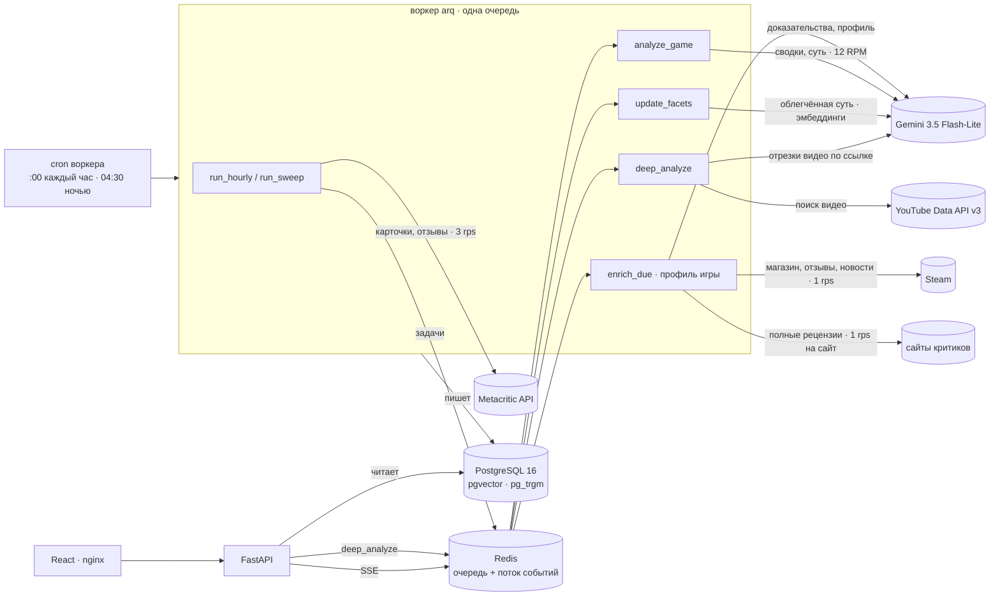
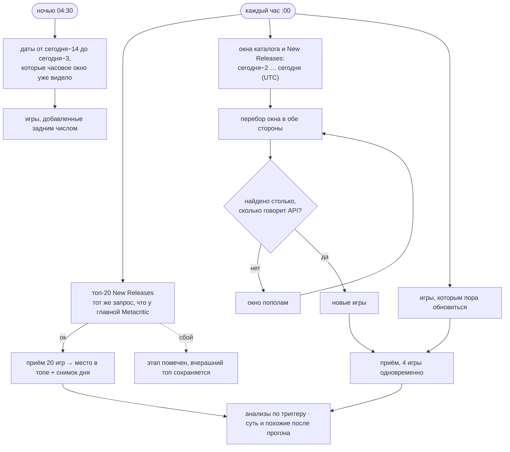
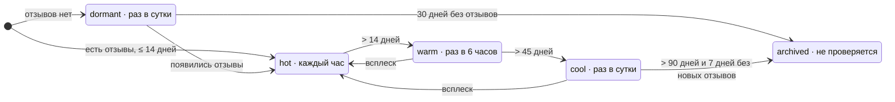
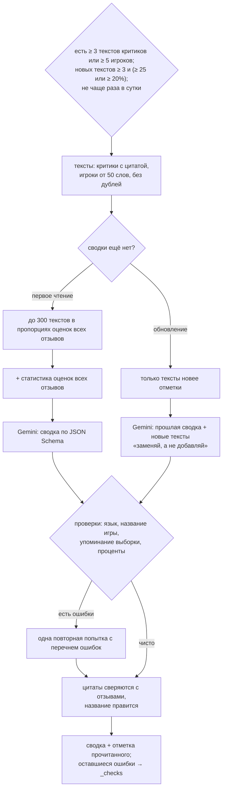
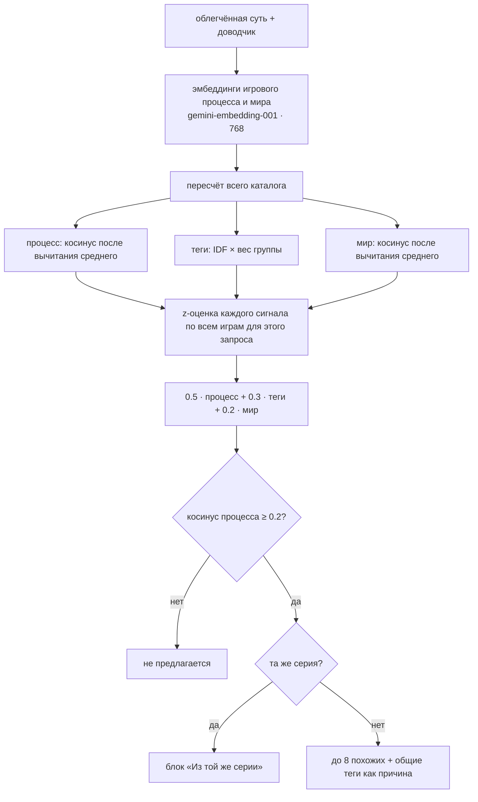
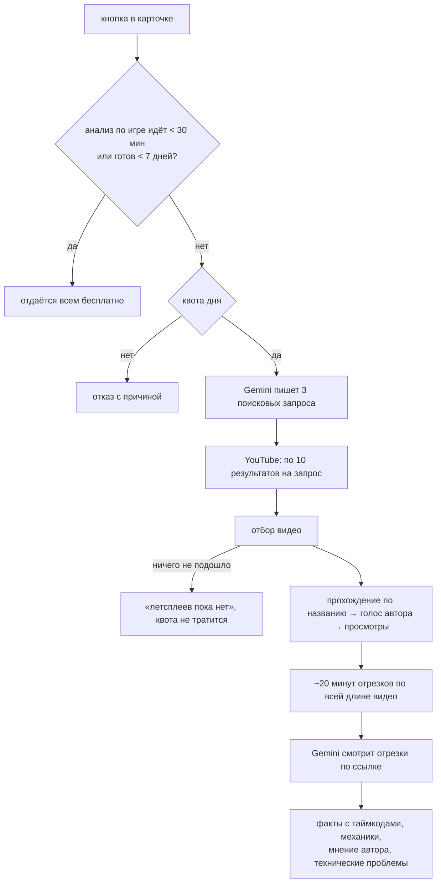
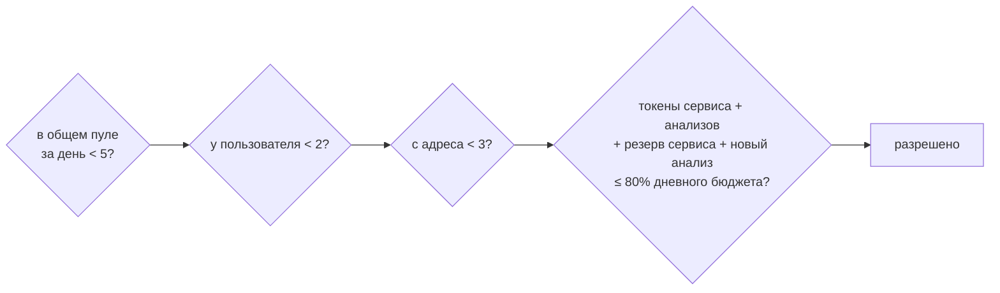
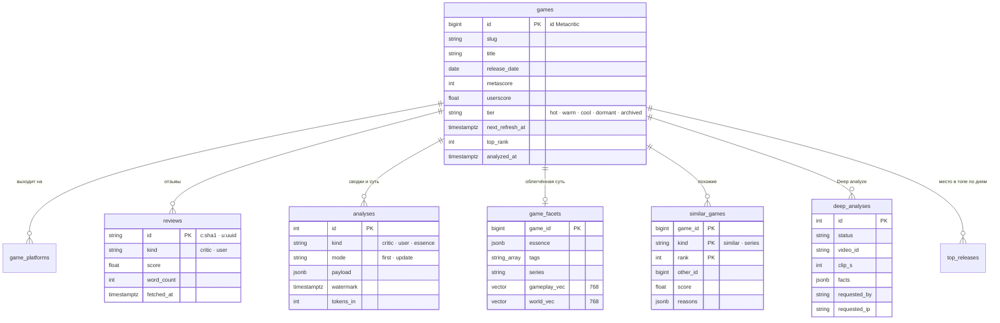

<h1 align="center">GameAnalytics</h1>

<p align="center">
  Аналитика выходящих видеоигр по данным Metacritic: новинки каждый час, сводки отзывов критиков и игроков,
  суть игры, похожие игры и разбор летсплеев с YouTube.
</p>

<p align="center">
  
  
  
  
  
  
  
  
</p>

---

## Возможности

- **Новинки каждый час.** Блок New Releases с главной Metacritic и весь каталог за последние три дня. Ничего не
  теряется: каждое окно дат сверяется с итогом API.
- **Сводки отзывов.** Модель Gemini отдельно сводит рецензии критиков и отзывы игроков:
  - что понравилось, что нет;
  - дословные цитаты;
  - технические проблемы;
  - пропорции мнений по всем оценкам.

  Модель читает только новые отзывы и не чаще раза в сутки.
- **Суть игры.** Жанр, игровой цикл, механики, сеттинг и теги из закрытого словаря. Строится для каждой игры с
  описанием, даже пока отзывов нет.
- **Похожие игры по сути, а не по жанру.** Векторы игрового процесса и мира плюс теги. Для каждой рекомендации видно,
  чем игры похожи; игры одной серии вынесены в отдельный блок.
- **Профиль игры по шести факторам — в реальном тестировании.** Идентичность, художественный крючок, геймдизайнерское
  ядро, эмоции, противоречия и рыночное отличие. Профиль строится по текстам Metacritic, Steam (магазин, отзывы с
  часами в игре, новости разработчика) и полным рецензиям. Каждый пункт ссылается на свои источники, а под профилем
  всегда виден индикатор наполненности: насколько суждениям можно доверять и чего не хватает. Фича работает на
  проде с 19.10.2026, профили заполняются постепенно в пределах суточных лимитов: новые игры сразу, прежний каталог
  по четверти в сутки. Исследование и путь от гипотезы — [docs/game-profile.md](docs/game-profile.md).
- **Deep analyze.** По кнопке модель находит популярное прохождение на YouTube, смотрит около 20 минут его отрезков
  по ссылке и выделяет факты, которых нет в описании магазина. Каждый факт — ссылка на нужную секунду видео.
- **DevPanel.** Работа пайплайна в реальном времени: какой узел активен, сколько запросов, где ошибки.
- **Работа на бесплатных ключах Google.** Темп запросов, дневной бюджет токенов и пул глубоких анализов
  рассчитаны так, чтобы работа сервиса всегда шла первой.

---

## Содержание

- [Архитектура](#архитектура)
- [Как это работает](#как-это-работает)
  - [Поиск новых игр](#поиск-новых-игр)
  - [Приём игры](#приём-игры)
  - [Частота обновления](#частота-обновления)
  - [Сводки отзывов](#сводки-отзывов)
  - [Суть игры](#суть-игры)
  - [Похожие игры](#похожие-игры)
  - [Deep analyze](#deep-analyze)
  - [Квоты](#квоты)
- [Модель данных](#модель-данных)
- [API](#api)
- [Интерфейс](#интерфейс)
- [Стек технологий](#стек-технологий)
- [Внешние сервисы и их лимиты](#внешние-сервисы-и-их-лимиты)
- [Надёжность](#надёжность)
- [Тестирование](#тестирование)
- [Обоснование решений](#обоснование-решений)
- [Ограничения](#ограничения)
- [Запуск](#запуск)
- [Настройки](#настройки)
- [Структура репозитория](#структура-репозитория)

---

## Архитектура



Принципы:
- **Вся работа — в воркере.** API только читает базу и ставит задачи в очередь. Воркер один, на этом держится
  восстановление после его перезапуска.
- **Каждый внешний вызов проходит через три слоя** (`backend/app/core`):
  - **лента** (`tape.py`) записывает и воспроизводит ответы;
  - **слой сбоев** (`faults.py`) подставляет отказы внешних сервисов;
  - **часы** (`clock.py`) можно заморозить.

  В продакшене все три прозрачны, а на тестовом стенде с их помощью сервис ломают и проверяют.
- **Каждое действие пишет событие в поток Redis.** DevPanel получает поток по SSE.
- **Снаружи доступен только nginx.** API, Postgres и Redis закрыты внутри сети Compose. Лимиты по адресу
  посетителя рассчитаны на заголовок, который ставит nginx.

---

## Как это работает

Все пороги взяты из кода и меняются переменными окружения (см. [Настройки](#настройки)).

### Поиск новых игр

`backend/app/pipeline/tasks.py` · `backend/app/pipeline/discovery.py`



- **Три независимых этапа:** топ, каталог, обновление. Сбой одного не отменяет остальные: прогон получает статус
  `partial` и записывает, что упало.
- **Перебор окна в обе стороны.** У игр с одинаковой датой API отдаёт нестабильный порядок, поэтому один проход
  теряет часть игр. Итог берётся из прохода от старых к новым: только он учитывает обе границы окна.
- **Пустая база наполняется тем же часовым циклом,** без отдельной начальной загрузки.

### Приём игры

`backend/app/pipeline/ingest.py`

1. **Карточка.** Запрос `composer`. Отпечаток карточки — оценки, число рецензий, платформы — сравнивается с
   сохранённым.
2. **Отзывы.** Запрашиваются, только если игра новая или отпечаток изменился. Для новой игры скачиваются все
   страницы по каждой платформе параллельно, для известной — от новых к старым до первого уже известного отзыва.
3. **Всплеск.** Если с последнего суточного снимка прибавилось не меньше 10% отзывов и не меньше 5, игра становится
   «горячей» на 24 часа.
4. **Уровень и анализ.** Пересчитываются уровень обновления и время следующей проверки, решается, нужен ли анализ.

Сырой ответ карточки сохраняется: новые поля можно извлечь без повторного сбора.

### Частота обновления

`backend/app/pipeline/tiers.py`



Возраст считается от даты релиза, а без неё — от даты обнаружения. Сервис следит за новинками, а не за всем
каталогом: игра в архиве больше не проверяется.

### Сводки отзывов

`backend/app/ai/lifecycle.py` · `selection.py` · `prompts.py` · `checks.py`



- **Критики и игроки разбираются отдельно** одним механизмом.
- **Короткие отзывы игроков не теряются.** Отзывы меньше 50 слов («шедевр», «худшая игра») модели как текст не
  передаются, но входят в статистику оценок. Поэтому пропорции мнений верны, а токены не тратятся на пустые тексты.
- **Выборка детерминирована.** Доли считаются по полосам оценок Metacritic: у игроков 0–4 / 5–7 / 8–10, у критиков
  0–49 / 50–74 / 75–100. Внутри полосы — половина самых длинных отзывов, остальное случайно, с зерном id игры.
- **Ответ строго по JSON Schema:**
  - сводка до 5 предложений и тон;
  - понравилось и не понравилось — до 6 пунктов каждое;
  - до 4 цитат, дословно и на языке оригинала;
  - до 4 технических проблем.
- **Проверки после генерации.** Отлавливаются ответ не на русском, опечатки в названии игры, упоминания «выборки»
  и проценты, которых нет в статистике. В этих случаях модель получает одну повторную попытку. Без модели правятся
  цитаты: изменённая заменяется точными словами отзыва, выдуманная удаляется.
- **Обновление не перечитывает прочитанное.** Модель получает прошлую сводку и только отзывы, пришедшие после
  отметки, — времени самого позднего прочитанного отзыва.

### Суть игры

`backend/app/ai/analyze.py` · `backend/app/ai/light_essence.py`

| | Полная суть | Облегчённая суть |
|---|---|---|
| Из чего | описание + сводки отзывов | только описание магазина и жанры |
| У каких игр | у игр с отзывами | у каждой игры с описанием от 150 символов |
| Поля | жанр, игровой цикл, механики, сеттинг, особенности, на что похожа | жанр, игровой процесс (до 450 символов), мир (до 300), теги, серия, похожие игры, уверенность |
| Для чего | карточка игры | похожие игры; карточка, пока нет отзывов |

- **Без собственных имён.** В текстах игрового процесса и мира облегчённой сути нет имён: имена тянут похожесть к
  названиям и франшизам вместо игрового процесса.
- **Закрытый словарь тегов:** 60 механик, 7 видов камеры, 5 режимов игры, 18 сеттингов, 10 тонов.
- **Перестройка только при изменениях.** Суть строится заново, лишь когда меняются название, жанры или описание.

**Доводчик** (`finish_essence`) добавляет то, что модель упустила, а тексты говорят прямо:
- **Серия.** Если в названии игры встречается уже известная серия, игра в неё входит. Числа нормализуются: «40,000»
  и «40K» — одно и то же.
- **Теги.** Словарь ключевых слов сверяется с жанрами Metacritic, жанром из сути, игровым процессом и описанием.
  Совпадение ищется только от начала слова. Теги только добавляются, никогда не удаляются.
- **Повтор по всем играм.** Доводчик повторно проходит по всем сохранённым сутям каждым запуском пересчёта, без
  вызовов модели.

### Похожие игры

`backend/app/pipeline/facets.py` · `backend/app/pipeline/similarity.py`



- **Центрирование.** Из каждого вектора вычитается средний по каталогу. Без этого косинусы коротких русских текстов
  все около 0.8 и ничего не различают.
- **Веса тегов** — IDF, умноженный на вес группы: механики 0.5, сеттинг 0.2, тон, вид и режимы по 0.1.
- **z-оценка по каждому запросу** приводит сигналы с разным разбросом к одной шкале.
- **Нижний порог.** z-оценка относительна: лучшие из слабых кандидатов всё равно набирают высокий балл. Порог
  абсолютной похожести игрового процесса отсекает их, и если близких игр мало, карточка так и говорит.
- **Жанр Metacritic в формулу не входит:** в слепом эксперименте он ухудшал любую смесь сигналов.
- **Пересчёт целиком.** Списки пересчитываются для всего каталога сразу, потому что среднее, веса тегов и z-оценки
  зависят от всех игр.

### Deep analyze

`backend/app/sources/youtube.py` · `backend/app/ai/deep.py` · `backend/app/pipeline/tasks.py`



**Отбор видео:**
- **Название.** Если в названии игры есть подзаголовок после двоеточия, обязателен он вместе с номером части:
  для «Warhammer 40,000: Boltgun 2» нужны «Boltgun» и «2». Приставка франшизы необязательна, римские цифры и
  сокращения вроде «40K» нормализуются. Номер части отсекает предыдущую игру серии.
- **Только прохождения.** Отсекаются:
  - записи стримов — по признаку прямой трансляции из API и по названию;
  - трейлеры, обзоры и реакции;
  - демо уже вышедшей игры;
  - видео короче 10 минут или длиннее 8 часов;
  - видео меньше 1000 просмотров.
- **Порядок выбора.** Сначала видео с признаками прохождения в названии, затем с голосом автора (его мнение — половина
  разбора), затем по просмотрам.

**Разбор видео:**
- **Отрезки.** Около 20 минут: 3 отрезка по 6.5 минуты, а для видео длиннее часа — 4 по 5 минут. Берутся по главам,
  если они есть, и всегда пропускают вступление.
- **Как модель смотрит.** Gemini читает публичное видео по ссылке: 1 кадр в 5 секунд, низкое разрешение, около 38
  токенов на секунду видео. Само видео никогда не скачивается.
- **Проверка и таймкоды.** Модель сама проверяет, что видео действительно про эту игру. Таймкоды пересчитываются от
  начала видео и становятся ссылками на нужную секунду YouTube.

**Статусы:**
- `done` и `mismatch` списывают квоту;
- `not_configured`, `no_video`, `search_error`, `failed` и `lost` её не списывают. `lost` — анализ, потерянный
  из-за перезапуска.

### Квоты

`backend/app/pipeline/quota.py`



- **Квотный день** начинается в полночь по тихоокеанскому времени, как у Google. Границы хранятся в UTC, поэтому
  дни перевода часов считаются верно.
- **Пользователь** — анонимный id из браузера. Лимит по адресу защищает от подделки этого id.
- **Работа сервиса всегда идёт первой.** Её токены — сводки, полная и облегчённая суть — зарезервированы до начала
  дня.
- **Готовый анализ квоту не тратит:** он отдаётся всем бесплатно 7 дней.

---

## Модель данных



Ещё две служебные таблицы: `pipeline_runs` — прогоны со статусом, владельцем и статистикой, и `raw_responses` —
последний сырой ответ карточки каждой игры.

Схема создаётся при старте. Новые колонки добавляются идемпотентными SQL-миграциями из `backend/app/core/db.py` под
advisory-блокировкой, чтобы API и воркер не мешали друг другу при одновременном старте.

---

## API

| Метод | Путь | Что делает |
|---|---|---|
| GET | `/api/games` | список: поиск по названию (триграммы), платформы, сортировка, топ, архив, пагинация |
| GET | `/api/games/{slug}` | карточка: оценки по платформам, сводки, суть, похожие, серия, Deep analyze |
| GET | `/api/games/{slug}/reviews` | отзывы критиков или игроков: платформа, сортировка, пагинация |
| GET | `/api/top?day=` | топ-20 New Releases за день |
| GET | `/api/platforms` | платформы с числом игр |
| GET | `/api/deep/quota` | остаток квоты Deep analyze и время сброса |
| POST | `/api/games/{slug}/deep-analyze` | запуск: 202, 429 с причиной или 503, если очередь недоступна |
| POST | `/api/pipeline/run` | ручной запуск часового цикла, ночного прохода или начальной загрузки |
| GET | `/api/pipeline/runs` · `/api/pipeline/stats` | прогоны и сводная статистика |
| GET | `/api/events/stream` | поток событий для DevPanel (SSE, с `Last-Event-ID`) |
| GET | `/api/health` | проверка жизни |

Все параметры ограничены: неверные значения дают 422, а не 500. Символы `%` и `_` в поиске ищутся как обычные.

---

## Интерфейс

`frontend/src`

- **Главная и список игр.** Поиск, фильтр по платформам, сортировка по оценкам, режим «Топ New Releases» с местом
  каждой игры.
- **Карточка игры:**
  - видео и описание;
  - оценки по платформам;
  - суть игры с тегами;
  - сводки критиков и игроков;
  - отзывы;
  - похожие игры с причинами и блок серии;
  - Deep analyze: остаток квоты, статус и факты со ссылками на нужную секунду видео.
- **DevPanel.** Граф узлов пайплайна — планировщик, discovery и топ, карточки, отзывы, уровни, AI-анализ, Deep
  analyze. Показывает активность и ошибки в реальном времени и поток событий с фильтрами.

---

## Стек технологий

| Слой | Технологии |
|---|---|
| Backend | Python 3.12, FastAPI, Uvicorn, Pydantic Settings |
| Фоновая работа | arq (очередь задач на Redis), asyncio, cron воркера |
| Данные | PostgreSQL 16, SQLAlchemy 2 (async), asyncpg, pgvector, pg_trgm |
| События | Redis Streams, Server-Sent Events |
| HTTP | httpx |
| LLM | Google Gen AI SDK, Gemini 3.5 Flash-Lite (thinking `minimal`), ответы по JSON Schema |
| Эмбеддинги | `gemini-embedding-001`, 768 измерений |
| Расчёты | NumPy |
| Видео | YouTube Data API v3, чтение публичного видео моделью Gemini по ссылке |
| Frontend | React 18, TypeScript 5, Vite 5, TanStack Query 5, React Router 6 |
| Отдача фронта | nginx 1.27 |
| Инфраструктура | Docker Compose: разработка, продакшен, отдельный проект тестового стенда |
| Качество | pytest, pytest-asyncio, ruff |

---

## Внешние сервисы и их лимиты

**Metacritic.** Используется JSON-бэкенд сайта `backend.metacritic.com`, ключ не нужен. Карточки, каталог и отзывы
по каждой платформе берутся не чаще 3 запросов в секунду и не больше 6 одновременно.

Особенности API, на которых построен поиск новых игр:
- **Нестабильный порядок.** Игры с одинаковой датой от страницы к странице идут в разном порядке.
- **Сортировка от новых к старым** игнорирует верхнюю границу дат и не показывает будущие игры.
- **Размер страницы.** Страница рецензий критиков — всегда 10 штук, отзывов игроков — до 500.
- **Кеш Cloudflare** держит ответы 10 минут.

**Gemini, бесплатный уровень.**
- **Квоты** считаются на проект Google и сбрасываются в полночь по тихоокеанскому времени.
- **Генерация.** Сервис держит 12 запросов в минуту и 2 одновременных. Дневной бюджет рассчитан от проверенного
  потолка в 1.16 млн входных токенов.
- **Эмбеддинги:** 100 текстов в минуту и 1000 в сутки на модель; сервис берёт не больше 900.
- **Видео YouTube по ссылке:** до 8 часов видео в сутки.

**Steam.** Публичные ответы магазина без ключа: поиск, страница игры, отзывы, новости разработчика. Не чаще
1 запроса в секунду: магазин отвечает 429 на всплески.

**Сайты критиков.** Полный текст рецензии по ссылке из Metacritic, не чаще 1 запроса в секунду на сайт. Текст
хранится только для анализа; наружу — короткие утверждения со ссылкой на рецензию.

**YouTube Data API v3.** Бесплатно, 10 000 единиц в сутки: поиск стоит 100 единиц, детали видео — 1. Один Deep
analyze тратит 301 единицу. Ключ передаётся в заголовке и не попадает ни в адреса, ни в логи.

---

## Надёжность

| Ситуация | Что происходит |
|---|---|
| Metacritic отвечает 5xx, 429, обрывает соединение | повторы с паузой и учётом `Retry-After`; этапы цикла независимы |
| Metacritic отдаёт страницу Cloudflare или изменил схему | ответ не принимается за данные, повторяется; этап помечается в прогоне |
| Gemini исчерпал лимит на минуту | ожидание по `retryDelay` из ответа |
| Gemini исчерпал суточный лимит | сразу ошибка, а не многочасовой сон воркера; следующий цикл попробует снова |
| Воркер убит посреди работы | при старте он закрывает свои брошенные прогоны и сразу перезапускает потерянные задачи |
| Deep analyze потерялся | через 30 минут получает статус `lost` и возвращает квоту |
| Перезапуск Postgres | соединения восстанавливаются, цикл продолжается |
| Недоступен Redis | чтение работает; Deep analyze отвечает 503 без списания квоты; поток событий ждёт и продолжает |
| Перезапуск Docker или сервера | все сервисы поднимаются сами (`restart: unless-stopped`) |
| Перезапуск API за nginx | адрес API разрешается заново на каждый запрос |

Нагрузка: один процесс API держит около 350 запросов в секунду, p95 меньше 200 мс при 50 одновременных
пользователях и 30 открытых потоках событий. Число процессов задаётся настройкой.

---

## Тестирование

- **Модульные тесты** (`backend/tests`) не обращаются к сети: поиск новых игр, уровни, выборка и статистика,
  сводки, проверки после модели, доводчик, похожие игры, выбор видео и отрезков, квоты, лента и сбои.
- **Интеграционные тесты** (`backend/tests/integration`) идут на настоящем Postgres: восстановление после убитого
  воркера, отказ очереди, границы параметров API, поиск, подделка id пользователя.
- **Тестовый стенд** ([stand/](stand/README.md)) — полный стек отдельным проектом Compose. В нём:
  - снимок рабочей базы и замороженные часы, чтобы любой прогон повторялся один в один;
  - записи ответов Metacritic, Gemini и YouTube, чтобы прогоны не тратили квоту;
  - подстановка сбоев внешних сервисов.

  На стенде запускаются сценарии поломок (`stand/chaos.py`, 12 сценариев) и нагрузочный тест (`stand/load.py`).
  Найденное и исправленное — в [stand/FINDINGS.md](stand/FINDINGS.md).

---

## Обоснование решений

| Решение | Почему |
|---|---|
| Gemini 3.5 Flash-Lite | лучшее качество за цену в слепом сравнении четырёх моделей: 4.41 из 5, около $0.02 на игру — [отчёт](docs/model-comparison.html) |
| Первое чтение до 300 содержательных отзывов, дальше ежедневные обновления | качество не ниже полного чтения при расходе в 13 раз меньше — [расчёт](docs/token-economics.html) |
| Похожие игры по граням и тегам с весами 0.5 / 0.3 / 0.2 | nDCG@5 0.80–0.82 против 0.42 у подбора по жанру; вдвое меньше «хабов» — [эксперимент](docs/similarity-experiment.md) |
| Порог похожести 0.2 | ниже него рекомендация оказывается промахом в 44–93% случаев — [проверка качества](docs/quality-mvp.md) |
| Полосы оценок как у Metacritic, отдельно для критиков | иначе рецензии на 75–79 считались бы «смешанными» |
| Проверки сводок после модели | дешёвый способ поймать ошибки быстрой модели без перехода на дорогую |
| Deep analyze через Gemini по ссылке | официальный и бесплатный путь; модель видит и слышит видео, а не только субтитры |
| Только прохождения, без стримов, демо и обзоров | смешанный контент вреднее честного «летсплеев пока нет» |
| Discovery окнами по дате с перебором в обе стороны | у API нестабилен порядок игр с одинаковой датой |
| Частота обновления по возрасту и активности игры | свежие и «горячие» игры важнее старых |

Скрипты экспериментов — в `backend/eval`, исследования API Metacritic — в `research`.

---

## Ограничения

- **Поздние добавления.** Игры, добавленные в каталог Metacritic с датой старше 14 дней, не находятся.
- **Отзывы и архив.** Правка старого отзыва не подхватывается: отзывы сохраняются один раз. Игра из архива не
  возвращается, даже если у неё снова пошли отзывы.
- **Серии.** Серия находится доводчиком, только если её уже назвала модель хотя бы у одной игры.
- **Короткие описания.** У игр с описанием короче 150 символов похожие подбираются запасным способом — по жанру.
- **Слово «live» в названии.** Ролики с «live» и «stream» в названии отсекаются, поэтому игра с таким словом в
  названии останется без летсплея.
- **Лимит видео YouTube.** Как Google считает 8 часов видео в сутки — по отрезкам или по полной длине, — не
  документировано. Поэтому длина видео ограничена, а пул анализов небольшой.
- **Аккаунтов нет.** Лимиты держатся на анонимном id браузера и адресе посетителя.
- **Один воркер на очередь:** на этом построено восстановление после его перезапуска.
- **Миграции** выполняются SQL-скриптами при старте, без Alembic.

---

## Запуск

### Разработка

Нужны Docker, Python 3.12 и Node 22.

```bash
docker compose up -d postgres redis
```

```bash
cd backend && python3 -m venv .venv && .venv/bin/pip install -r requirements-dev.txt
```

Ключи кладутся в `backend/.env`, образец — `backend/.env.example`:
- `GA_LLM_PROVIDER=gemini` и `GA_GEMINI_API_KEY` — ключ Google AI Studio;
- `GA_YOUTUBE_API_KEY` — YouTube Data API v3, для Deep analyze.

API, воркер и интерфейс (http://localhost:5173):

```bash
cd backend && .venv/bin/uvicorn app.api.main:app --reload
```

```bash
cd backend && .venv/bin/arq app.pipeline.tasks.WorkerSettings
```

```bash
cd frontend && npm install && npm run dev
```

Один часовой цикл прямо в терминале и анализ выбранных игр:

```bash
cd backend && .venv/bin/python -m app.cli inline hourly
```

```bash
cd backend && .venv/bin/python -m app.cli analyze castlevania-belmonts-curse
```

Тесты. Для интеграционных нужна база `ga_test`:

```bash
cd backend && .venv/bin/pytest
```

```bash
docker compose exec postgres createdb -U ga ga_test
```

```bash
cd backend && GA_TEST_DATABASE_URL=postgresql+asyncpg://ga:ga@localhost:5432/ga_test .venv/bin/pytest tests/integration
```

### Полный стек локально

Интерфейс откроется на http://localhost:8080:

```bash
docker compose up -d --build
```

### Продакшен

[deploy/compose.yml](deploy/compose.yml) и [deploy/deploy.sh](deploy/deploy.sh) разворачивают сервис на одном VPS.
- **Порты.** Снаружи открыт только nginx на 80-м порту.
- **Секреты.** Ключи и случайный пароль базы создаются на сервере в `deploy/.env` с правами 600.
- **Адрес сервера** берётся из `GA_HOST` или из файла `deploy/.host`; оба в git не попадают.
- **Доступ** только по SSH-ключу.

```bash
deploy/deploy.sh up
```

Другие команды: `check`, `install-docker`, `status`, `logs [сервис]`, `backup`, `db-copy`.

---

## Настройки

Все параметры — в [backend/app/core/config.py](backend/app/core/config.py). Любой переопределяется переменной `GA_*`
в окружении или в `backend/.env`.

| Переменная | По умолчанию | Что задаёт |
|---|---|---|
| `GA_LLM_PROVIDER`, `GA_LLM_MODEL`, `GA_LLM_THINKING_LEVEL` | `none`, `gemini-3.5-flash-lite`, `minimal` | модель |
| `GA_GEMINI_API_KEY`, `GA_YOUTUBE_API_KEY` | — | ключи |
| `GA_GEMINI_API_KEYS` | — | ещё ключи Gemini через запятую: берутся по очереди, бюджет растёт с их числом |
| `GA_PROFILE_ENABLED`, `GA_PROFILE_MIN_FULLNESS` | `true`, 60 | профиль игры и порог наполненности для него |
| `GA_PROFILE_PER_RUN`, `GA_PROFILE_NEW_DAYS`, `GA_PROFILE_BACKLOG_SHARE`, `GA_PROFILE_TOKEN_SHARE` | 40, 3, 0.25, 0.6 | выкатка профилей: новые игры, доля прежнего каталога в сутки, доля токенов |
| `GA_STEAM_REVIEWS_CAP`, `GA_STEAM_RPS`, `GA_CRITIC_RPS` | 100, 1, 1 | сбор со Steam и сайтов критиков |
| `GA_RATE_LIMIT_RPS`, `GA_MAX_CONCURRENCY` | 3, 6 | темп запросов к Metacritic |
| `GA_LLM_RPM`, `GA_LLM_CONCURRENCY` | 12, 2 | темп запросов к Gemini |
| `GA_DISCOVERY_WINDOW_DAYS`, `GA_SWEEP_DAYS` | 3, 14 | окна часового и ночного прохода |
| `GA_HOT_DAYS`, `GA_WARM_DAYS`, `GA_COOL_DAYS`, `GA_QUIET_DAYS`, `GA_DORMANT_DAYS` | 14, 45, 90, 7, 30 | частота обновления |
| `GA_ANALYSIS_MIN_CRITIC`, `GA_ANALYSIS_MIN_USER` | 3, 5 | минимум текстов для сводки |
| `GA_REANALYZE_RATIO`, `GA_REANALYZE_MIN_NEW`, `GA_REANALYZE_FLOOR` | 0.20, 25, 3 | когда обновлять сводку |
| `GA_EMBED_MODEL`, `GA_EMBED_DAILY_TEXTS` | `gemini-embedding-001`, 900 | эмбеддинги |
| `GA_SIMILAR_MIN_GAMEPLAY` | 0.2 | нижний порог похожести |
| `GA_DEEP_DAILY_POOL`, `GA_DEEP_PER_USER`, `GA_DEEP_PER_IP` | 5, 2, 3 | пул Deep analyze |
| `GA_DEEP_MIN_VIEWS`, `GA_DEEP_MAX_VIDEO_S`, `GA_DEEP_CLIP_TOTAL_S` | 1000, 28800, 1200 | выбор видео и отрезков |
| `GA_LLM_DAILY_TOKENS`, `GA_LLM_SAFETY`, `GA_SERVICE_RESERVE_TOKENS` | 1 160 000, 0.8, 190 000 | дневной бюджет токенов |
| `GA_API_WORKERS` (Compose) | 2 | процессы API |
| `GA_TAPE_MODE`, `GA_FROZEN_NOW`, `GA_CRON_ENABLED`, `GA_FAULTS` | `live`, —, `true`, — | тестовый стенд |

---

## Структура репозитория

```
backend/
  app/
    api/main.py          FastAPI: эндпоинты, квота, поток событий
    pipeline/            tasks — задачи воркера; discovery, ingest, tiers, top — сбор;
                         facets, similarity — похожие игры; quota — пул Deep analyze
    ai/                  gemini — провайдер; prompts; selection — выборка и статистика;
                         lifecycle — сводки; checks — проверки после модели;
                         analyze — полная суть; light_essence — облегчённая суть и доводчик; deep — разбор видео
    scraper/             клиент Metacritic: темп, повторы; запросы; разбор ответов
    profile/             профиль игры: сбор документов, доказательства, наполненность, профиль, выкатка
    sources/             youtube — видео и отрезки; steam — магазин, отзывы, новости; critics — полные рецензии;
                         web — HTTP-клиент новых платформ
    core/                config, db (схема и миграции), clock, tape, faults
    events/bus.py        поток событий в Redis
    cli.py               ручные запуски
  tests/                 модульные; integration/ — на Postgres
  eval/                  эксперименты: модели, экономика, стратегии чтения, похожие игры, качество
frontend/                React + Vite, nginx.conf
deploy/                  продакшен: compose.yml, deploy.sh
stand/                   тестовый стенд: compose, stand.sh, chaos.py, load.py
research/                наблюдатели и замеры API Metacritic
docs/                    отчёты экспериментов
```
