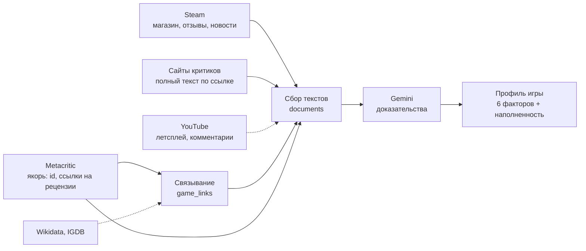

# Профиль игры: шесть факторов и наполненность

Октябрь 2026. Путь фичи от гипотезы до первого внедрения: вопрос, оценка идеи, расход токенов, схема платформ,
исследование на 20 играх, каркас и выкатка на прод. Как шла работа и почему принято каждое решение — в
разделе «Ход работы».

> **Статус: в реальном тестировании.** Фича работает на проде с 19.10.2026. Профили заполняются постепенно, в
> пределах суточных лимитов: все новые игры сразу, прежний каталог — по четверти в сутки (см. «Выкатка»).

## Зачем

Сводки отзывов отвечают на вопрос «что говорят». Профиль отвечает на вопрос «почему игра работает и для кого».
Он полезен тем, кто оценивает проект для вложений или разбирает успех и провал вышедшей игры. Профиль описывает
и объясняет, а не предсказывает продажи или оценки. Каждое его утверждение стоит на доказательстве со ссылкой
на источник.

| Фактор | Вопрос |
|---|---|
| 1. Ключевая идентичность | Какую роль и основной опыт предлагает игра? Что обязано сохраниться, чтобы она оставалась собой? |
| 2. Художественный крючок | Какое выразительное решение делает её узнаваемой: визуальный язык, звук, повествование, необычное сочетание? |
| 3. Геймдизайнерское ядро | Что игрок делает постоянно, какие решения принимает, как работают риск и награда? |
| 4. Эмоциональное предложение | Какие переживания создаёт игра и за счёт каких решений? |
| 5. Противоречия и ограничения | Где сильная сторона одновременно отталкивает? Для кого опыт перестаёт работать? |
| 6. Рыночная дифференциация | Чем игра отличается от ближайших альтернатив и кому это отличие важно? |

Без индикатора наполненности суждениям модели нельзя доверять. Поэтому под профилем всегда видно, на скольких
и каких данных он построен. Если данных мало, профиль не строится, а карточка показывает, чего не хватает.

## Ход работы

Хронология фичи: что выяснялось на каждом шаге и какое решение из этого следовало.

### 1. Вопрос: хватит ли Metacritic

Перед тем как что-то строить, разобрали, что сервис на самом деле знает об игре.

- **Критики.** Metacritic отдаёт только выдержку в одно-три предложения и ссылку на полную рецензию. Модель до
  этого видела одни выдержки.
- **Игроки.** Полные тексты, но без контекста автора: неизвестно, сколько он играл и рекомендует ли игру.
- **Охват.** У 410 из 456 игр каталога (90%) не было ни одного отзыва на Metacritic. Это инди, которые живут в
  Steam.
- **Неиспользованные данные.** В сохранённых ответах Metacritic уже лежат опрос GameFAQs (время прохождения,
  сложность) и официальная франшиза игры.

**Решение:** Metacritic остаётся якорем — id игры и ссылки на рецензии. Тексты нужно добирать с других платформ:
в первую очередь отзывы Steam и полные рецензии по ссылкам Metacritic.

### 2. Оценка идеи до кода

Идею оценили как сильную при четырёх условиях (раздел «Оценка идеи»): проверка на шаблонность, разрешённый
ответ «мало данных», фактор 1 как итог остальных и честное позиционирование — разбор вышедших игр, а не прогноз.
Посчитали расход токенов по видам документов и классам игр и нарисовали схему платформ.

**Решение:** не строить сразу краулеры на все платформы, а сначала измерить на реальных граничных случаях, какая
платформа что добавляет.

### 3. Тест на 20 играх

Выборку взяли из граничных случаев, потому что из них состоит почти весь каталог: игры с несколькими рецензиями,
только с отзывами игроков и вовсе без отзывов, включая консольные эксклюзивы.

Как устроили тест:
- **Одно чтение на платформу.** Модель читает документы каждой платформы один раз и извлекает доказательства по
  шести факторам. Уровни L0–L5 — объединения этих доказательств, поэтому сравнение уровней не стоит ни одного
  лишнего вызова.
- **Метрика наполненности считается кодом,** а не моделью: модель только находит доказательства, а их полноту
  оценивает формула.
- **Две проверки устойчивости:** строгий вариант метрики (8 пунктов на фактор вместо 3) и вклад «без одной
  платформы», который не зависит от порядка подключения.

Что выяснили и что из этого решили:

| Результат | Решение |
|---|---|
| Один Metacritic не довёл до порога ни одной игры (медиана 27) | Профиль не строится по одному Metacritic |
| Отзывы Steam проводят через порог 14 игр из 20 | Steam — обязательный источник |
| Насыщение наступает между 25 и 100 отзывами Steam | Брать до 100 отзывов, выборкой по сетке «рекомендует × часы» |
| Полные рецензии и YouTube почти не меняют, кто проходит порог, но добавляют глубину | Рецензии — в каркас; YouTube отложен |
| Wikidata не знает свежих игр (0 из 20) | Связывать со Steam поиском по точному названию со сверкой разработчика |
| «20+ отзывов Steam» точно разделило прошедшие и не прошедшие игры | Дешёвый признак, что профиль стоит строить |
| Фактор 4 (эмоции) самый слабый | Эмоция конкретна, только если названо решение игры, которое её вызывает |
| В пакете рецензий модель ссылается сразу на все документы | Ссылки проверяются кодом, выдуманные отбрасываются |

### 4. Индикатор наполненности обязателен

Главное требование к интерфейсу: без видимой меры того, на чём стоят суждения модели, им нельзя доверять.

**Решение:** индикатор показывается под профилем всегда:
- шкала 0–100 с отметкой порога;
- покрытие каждого фактора;
- источники с объёмом;
- что именно не хватает.

Профиль строится только от наполненности 60. Ниже карточка прямо пишет, что данных мало.

### 5. Каркас

Решения в коде:
- **Одна таблица документов** для всех платформ. Новая платформа — новый источник, а не новая схема.
- **Каждый документ читается моделью один раз.** Обновление читает только новые документы, как сводки отзывов.
- **Слова разработчика — заявление, а не подтверждение.** Текст магазина и новости весят треть и не
  подтверждают фактор.
- **Связь со Steam только при совпадении разработчика.** Чужая игра с тем же названием отравила бы все шесть
  факторов.
- **Неудачная ссылка на рецензию запоминается** и не скачивается повторно.
- **Профиль пересобирается,** когда доказательств стало на 20% больше.
- **Несколько ключей Gemini по очереди.** Ключ, упёршийся в дневной лимит, откладывается, бюджеты растут с числом
  ключей.

Каркас проверили сквозным прогоном на 4 играх: результаты совпали с тестом. Allogloom набрал 100, Hubert 78 — у
обеих построен профиль. Demonator набрал 44, Rudolph 3 — у обеих «мало данных».

### 6. Выкатка

**Режим:** все новые игры сразу, прежний каталог по четверти в сутки, не больше 60% суточного бюджета токенов на
профили (раздел «Выкатка»). Так каталог заполняется за несколько дней, не отнимая квоту у сводок и Deep analyze.

**Первый прогон на проде** (19.10.2026) прошёл без ошибок:
- 40 игр за 9 минут: 31 новая и 9 из прежнего каталога;
- 9 профилей построено;
- 393 тыс. входных и 72 тыс. выходных токенов — около пятой части суточной доли профилей.

**Что всплыло.** 17 игр из 40 не нашлись в Steam. Это консольные эксклюзивы и игры, вышедшие в тот же день: поиск
Steam ещё их не отдаёт. Повторный поиск для них через 7 дней для новинок слишком редкий — это первая доработка.

### Что не публикуется в репозитории

- **Сырые данные теста** (`backend/eval/results/enrichment/`): в них полные тексты рецензий изданий, отзывы Steam
  и комментарии YouTube — чужие тексты. Все цифры из них приведены в этом документе.
- **Журнал рабочей сессии:** в нём детали доступа к серверу и инфраструктуре. Ход работы изложен выше.

## Гипотеза

Сервис собирал отзывы с Metacritic и сводил их в краткие сводки. Вопрос был в том, какой слой аналитики можно
отдать языковой модели так, чтобы не уйти в предиктивную аналитику, которая уже существует. Компании полезнее
глубокий разбор нескольких целевых характеристик игры, которые модель может оценить по текстам: для решения о
вложениях в проект или для понимания, почему игра выстрелила или провалилась. Отсюда шесть факторов (таблица
выше).

Сразу встал второй вопрос: хватит ли для этого текстов одного Metacritic. Возможно, Metacritic стоит оставить
главным связующим звеном и добавить сбор с других платформ, чтобы брать всё, что известно об игре сейчас. Это же
перестроило бы подбор похожих игр.

## Оценка идеи

Идея сильная: модель здесь сводит большой объём текста в объяснение с доказательствами, и в этом она сильна.
Прогнозов продаж или оценок идея не требует, поэтому граница с предиктивкой проходит естественно.

Что ценно:
- **Отвечает на «почему», а не на «сколько».** Числа (продажи, онлайн, выручку) уже дают SteamDB, Gamalytic и
  VG Insights. Структурного объяснения, почему игра работает и для кого, у них нет.
- **Фактор 5 самый ценный и самый редкий.** «Сильная сторона, которая отталкивает» и «для кого перестаёт работать»
  нужны для решения о вложениях и для разбора провала, и их нет в сводках.
- **Синергия с продуктом.** Профиль улучшает подбор похожих игр, а похожие игры дают базу для фактора 6.

Риски и как их снять:
1. **Шаблонность** («атмосферный мир, затягивающий геймплей»). Нужна проверка различимости: утверждение остаётся,
   только если оно не так же верно для ближайших соседей.
2. **Обязанность найти крючок.** У каждого фактора должен быть разрешённый ответ «не выражено» или «мало данных».
3. **Факторы пересекаются.** Идентичность (1) — итог 3–5 обязательных элементов со ссылками на 2–4, а не ещё
   один пересказ.
4. **Парадокс времени.** Для вложений ценнее всего момент до релиза, когда данных меньше всего. Честное
   позиционирование — разбор вышедших игр и конкурентов; для невышедших — частичный профиль с низкой уверенностью.

Ещё две оговорки: пишут отзывы не все игроки (смещение выборки), а эталона качества нет — нужны слепая оценка по
рубрике, проверка ссылок и стабильность между прогонами.

## Расход токенов: из чего он складывается

Цены Gemini 3.5 Flash-Lite: $0.30 за 1 млн входных и $2.50 за 1 млн выходных токенов (`backend/app/ai/gemini.py`).
Ниже — оценки до исследования; исследование их уточнило (см. «Расход» в результатах).

| Документ | Токенов |
|---|---|
| Полная рецензия критика | ~2 200, обрезка до 3 000 |
| Отзыв Steam от 50 слов | ~200 |
| Текст магазина Steam | ~1 500 |
| Патчноут | ~2 000 |
| Факты Deep analyze | ~2 000 |
| 100 комментариев YouTube | ~3 000 |
| Инструкция извлечения на пакет | ~1 500 |

Два шага модели:
- **Извлечение доказательств.** Вход — документы, выход — около 15% от входа. Читаются только новые документы.
  Выход стоит в 8 раз дороже входа, поэтому тезисы должны быть короткими.
- **Профиль.** Вход — доказательства и инструкция, выход — 3–4 тыс. Маленький шаг; при необходимости его можно
  отдать более сильной модели.

| Класс игры | Первое чтение, вход | Выход | Цена |
|---|---|---|---|
| Крупная: 30 рецензий, 300 отзывов Steam, патчи, видео | ~180 тыс. | ~24 тыс. | ~$0.11 |
| Средняя: 20 рецензий, 150 отзывов Steam | ~105 тыс. | ~15 тыс. | ~$0.07 |
| Инди со Steam: 0–3 рецензии, 40 отзывов | ~25 тыс. | ~3 тыс. | ~$0.015 |
| Без отзывов | профиль не строится | | 0 |

Обновления читают только новые документы: около 40% стоимости первого чтения.

## Схема платформ



Пунктир — проверено и отложено. Wikidata не знает свежих игр (0 из 20). IGDB требует ключей Twitch. Комментарии
YouTube под трейлерами дают мало.

## Исследование: где игра получает достаточно данных

Скрипт: `backend/eval/enrichment.py` (`collect` → `extract` → `score` → `export`). Сырые данные теста хранятся
локально в `backend/eval/results/enrichment/` и в репозиторий не попадают: в них полные тексты рецензий изданий,
отзывы Steam и комментарии YouTube, то есть чужие тексты. Все числа из них приведены ниже.

### Выборка

20 свежих игр из базы прода от 18.10.2026. В каталоге тогда было 456 игр, у 410 из них (90%) не было ни одного
отзыва на Metacritic. Поэтому выборка составлена из граничных случаев:

- 8 игр с 4–10 рецензиями критиков;
- 5 игр с 1–3 рецензиями;
- 2 игры только с отзывами игроков;
- 5 игр без отзывов, среди них два консольных эксклюзива и одна ещё не вышедшая игра.

### Как устроен тест

Платформы добавлялись по одной, уровни накопительные:

| Уровень | Что добавляется |
|---|---|
| L0 | Metacritic: описание, выдержки критиков, отзывы игроков, опрос GameFAQs |
| L1 | Магазин Steam: описание, метки игроков, возможности, цена |
| L2 | Отзывы Steam: до 300 свежих, от 15 слов, с часами в игре и «рекомендую / нет» |
| L3 | Новости разработчика в Steam: патчноуты, девлоги |
| L4 | Полные тексты рецензий по ссылкам из Metacritic |
| L5 | Комментарии под самым обсуждаемым видео YouTube и факты Deep analyze |

Gemini 3.5 Flash-Lite по каждой платформе отдельно извлекает доказательства по шести факторам. Каждое
доказательство — это:

- короткое утверждение;
- номера документов, на которых оно стоит;
- флаг, конкретное ли оно;
- плюс, минус или нейтрально;
- для кого оно верно;
- флаг, заявление ли это разработчика.

Уровень — объединение доказательств его платформ. Поэтому уровни не требуют лишних вызовов модели.

### Метрика наполненности

- **Оценка фактора** = 0.75 × покрытие + 0.25 × подтверждение.
- **Покрытие** — конкретные утверждения, до трёх штук. Слова магазина и новостей разработчика — заявления, они
  весят треть.
- **Подтверждение** — фактор видят два разных вида источников: игроки, критики, разработчик, видео.
- **Фактор 5** считает только минусы и утверждения «для кого».
- **Наполненность** — среднее шести факторов × 100.
- **Порог 60:** у большинства факторов есть конкретные и подтверждённые доказательства, профиль стоит строить.
- **Строгий вариант** — 8 конкретных утверждений на фактор вместо 3. Он проверяет, что выводы не держатся на
  потолке метрики.

### Результаты

| Уровень | Медиана | Игр ≥ 60 | Медиана, строго | Игр ≥ 60, строго | Входных токенов модели, накопительно |
|---|---|---|---|---|---|
| L0 Metacritic | 27 | 0 | 15.5 | 0 | 22 тыс. |
| L1 + магазин Steam | 31.5 | 2 | 17 | 0 | 40 тыс. |
| L2 + отзывы Steam | 80 | 14 | 45.5 | 7 | 515 тыс. |
| L3 + новости Steam | 83.5 | 15 | 53.5 | 8 | 617 тыс. |
| L4 + полные рецензии | 90.5 | 15 | 61.5 | 11 | 715 тыс. |
| L5 + YouTube | 93 | 15 | 69.5 | 13 | 754 тыс. |

Медиана по группам игр (по отзывам на Metacritic):

| Группа | L0 | L2 | L5 |
|---|---|---|---|
| Без отзывов (5) | 4 | 12 | 44 |
| Только игроки (2) | 13 | 45.5 | 49 |
| 1–3 критика (5) | 28 | 79 | 96 |
| 4–10 критиков (8) | 37 | 95 | 100 |

Медиана оценки фактора, от 0 до 100:

| Уровень | 1 | 2 | 3 | 4 | 5 | 6 |
|---|---|---|---|---|---|---|
| L0 | 8 | 38 | 27 | 0 | 38 | 38 |
| L2 | 85 | 79 | 90 | 38 | 100 | 94 |
| L5 | 100 | 100 | 100 | 73 | 100 | 100 |

Вклад платформы без учёта порядка подключения: насколько в среднем падает наполненность, если убрать только её.

| Платформа | Игр с текстом | Токенов текста | Потеря | Потеря, строго | Одна, медиана |
|---|---|---|---|---|---|
| Metacritic | 20 | 13 153 | 2.7 | 5.0 | 27 |
| Магазин Steam | 18 | 10 583 | 1.4 | 1.6 | 6 |
| Отзывы Steam | 16 | 372 796 | 11.1 | 17.5 | 56 |
| Новости Steam | 14 | 90 929 | 1.2 | 3.3 | 19.5 |
| Полные рецензии | 12 | 105 136 | 2.1 | 5.3 | 32 |
| YouTube | 16 | 31 429 | 2.0 | 3.9 | 18 |

Насыщение по отзывам Steam (все платформы, отзывы обрезаны до N свежих):

| N | Медиана | Игр ≥ 60 | Медиана, строго | Игр ≥ 60, строго | Токенов текста отзывов |
|---|---|---|---|---|---|
| 0 | 84 | 13 | 50.5 | 7 | 0 |
| 25 | 90 | 15 | 60.5 | 10 | 63 тыс. |
| 50 | 90 | 15 | 61 | 10 | 120 тыс. |
| 100 | 90 | 15 | 67 | 12 | 203 тыс. |
| 300 | 93 | 15 | 69.5 | 13 | 373 тыс. |

### Выводы

1. **Одного Metacritic недостаточно ни для одной игры.** Медиана 27, порог не прошла ни одна игра. Metacritic дал
   от 75 до 2 900 токенов текста на игру, все платформы вместе — до 101 тыс.
2. **Решают отзывы Steam.** С ними порог проходят 14 игр из 20. Они же единственный источник контекста игрока
   (часы в игре, рекомендация), на котором стоит фактор 5.
3. **Остальные платформы дают глубину, а не проходной балл.** Со всеми платформами порог проходят 15 из 20.
   Под строгой метрикой вклад полных рецензий и YouTube растёт: 8 → 11 → 13 игр.
4. **Хватает 25–100 отзывов Steam.** Первые 25 дают почти весь прирост, до 100 растёт глубина, дальше — мало.
   Ограничение в 100 отзывов экономит 45% токенов текста по сравнению с 300.
5. **Дешёвый предфильтр.** На выборке «20+ отзывов Steam» точно разделило игры на прошедшие порог и не прошедшие.
6. **Пять игр не прошли порог ни на одной платформе.** Это игры без отзывов нигде, консольные эксклюзивы и
   невышедшая игра. Им нужен честный статус «мало данных».

### Связывание и сбор

- **Steam:** поиск по точному названию нашёл 18 игр из 18, что есть в Steam; у всех совпал разработчик. Двух
  консольных эксклюзивов в Steam нет.
- **Wikidata** (Metacritic ID → Steam ID): 0 из 20. Свежих игр там нет.
- **Полные рецензии** извлечены по 54 ссылкам из 80 (68%): мешают платный доступ, Cloudflare и короткие страницы.
- **YouTube:** одно ложное совпадение по названию из 17. Комментарии под трейлерами дают мало.
- **IGDB** не проверялся: нет ключей Twitch.

### Что не работает

- **Фактор 4 (эмоции) самый слабый:** 73 даже на L5. Модель половину эмоциональных утверждений помечает как общие
  слова. Нужно переопределить конкретность для эмоций: эмоция плюс решение, которое её создаёт.
- **Ссылки на документы грубые.** В пакете полных рецензий модель часто ссылается на все документы сразу.
  Выдумок при ручной проверке не найдено, но ссылки нужно проверять кодом.
- **Порог 60 и веса метрики не откалиброваны:** 20 игр — проверка состоятельности, а не эталон.

### Расход

754 тыс. входных и 77 тыс. выходных токенов на 20 игр. Это около $0.42 по платному тарифу 3.5 Flash-Lite. YouTube
потратил около 2 тыс. единиц квоты из 10 тыс.

## План внедрения

Каждый этап — отдельный коммит в ветке `feature/game-profile`.

1. **Хранилище.** Таблицы связей с внешними платформами, документов, доказательств и профилей. Документ —
   единица текста любого источника: источник, вид, внешний id, текст, метаданные (часы, рекомендация, оценка,
   издание), отпечаток.
2. **Связывание со Steam.** Поиск по точному нормализованному названию, сверка разработчика. Способ связи
   сохраняется; ссылку можно поправить вручную.
3. **Сбор.**
   - Магазин Steam.
   - Отзывы Steam: до 100, по сетке «рекомендует или нет × часы игры».
   - Новости разработчика.
   - Полные рецензии по ссылкам Metacritic.

   Каждый внешний вызов проходит через ленту и слой сбоев, как Metacritic и YouTube. Частота сбора следует
   уровням hot/warm/cool.
4. **Доказательства.** Извлечение только по новым документам, как в сводках. Номера документов в ответе
   проверяются кодом, несуществующие отбрасываются.
5. **Наполненность** считается кодом по формуле выше, после каждого сбора. Профиль строится от 60, ниже карточка
   показывает «мало данных» и чего не хватает.
6. **Профиль.** Модель сводит доказательства в шесть факторов, каждое утверждение — со ссылками на источники.
7. **Интерфейс.** Блок «Профиль игры» в карточке, под ним индикатор наполненности:
   - шкала 0–100 с полосами: меньше 30 — «скудно», 30–60 — «частично», 60–80 — «достаточно», от 80 — «богато»;
   - покрытие каждого из шести факторов;
   - источники с объёмом;
   - подсказка, чего не хватает.
8. **Квоты.** Токены профилей входят в расход сервиса. Ключей Gemini несколько, бюджет растёт с их числом.

Следующим этапом, когда профили наберутся: похожие игры по факторам 1–4 и проверка различимости фактора 6
против соседей.

### Бюджет

- **Квота:** суточный бюджет — `GA_LLM_DAILY_TOKENS` на каждый ключ с запасом `GA_LLM_SAFETY`.
- **Поток:** в каталог приходит около 45 игр в день, профиль нужен примерно трети из них. Это около 25 тыс.
  токенов на игру при 100 отзывах Steam, с обновлениями — около 0.5 млн в сутки.
- **Разовая догрузка** всего каталога — 3–5 млн токенов, одни-двое суток.

## Каркас (сделано)

| Что | Где |
|---|---|
| Таблицы `game_links`, `documents`, `evidence`, `game_profiles`, `profile_calls` | `backend/app/models.py` |
| HTTP-клиент новых платформ: темп по сайту, повторы, лента, сбои (`steam`, `critics`) | `backend/app/sources/web.py` |
| Steam: поиск, магазин, отзывы с выборкой по сетке, новости | `backend/app/sources/steam.py` |
| Полные рецензии по ссылкам Metacritic | `backend/app/sources/critics.py` |
| Сбор документов игры в одну таблицу | `backend/app/profile/collect.py` |
| Извлечение доказательств, проверка ссылок на документы | `backend/app/profile/evidence.py` |
| Наполненность, полосы, «чего не хватает» | `backend/app/profile/fullness.py` |
| Сборка профиля по шести факторам | `backend/app/profile/build.py` |
| Один проход по игре и данные для карточки | `backend/app/profile/pipeline.py` |
| Задачи воркера `enrich_game`, `enrich_due` | `backend/app/pipeline/tasks.py` |
| Блок «Профиль игры» и индикатор наполненности | `frontend/src/components/ProfileBlock.tsx` |

**Расписание.** Обход `enrich_due` ставится после каждого прогона поиска игр. Он берёт до `GA_PROFILE_PER_RUN`
игр (по умолчанию 40): сначала ещё не обогащённые, потом те, кому пора. Порядок: топ New Releases, самые
обсуждаемые, самые свежие. Следующий проход зависит от уровня игры: hot — через сутки, warm — через трое, остальные —
через неделю. Профиль пересобирается, когда доказательств стало на 20% больше.

**Ручной запуск:**

```bash
cd backend && .venv/bin/python -m app.cli enrich hubert allogloom
```

```bash
cd backend && .venv/bin/python -m app.cli enrich-due 40
```

**Квота.** Токены профилей входят в расход сервиса (`profile_calls`). Ключи Gemini задаются в `GA_GEMINI_API_KEYS`
через запятую, бюджет растёт с их числом.

**Ещё не сделано:**
- комментарии YouTube как источник;
- узлы профиля в DevPanel;
- проверка различимости фактора 6 против соседей;
- похожие игры по факторам;
- проверки текста профиля после модели (опечатки, чужие буквы);
- калибровка порога и весов на большей выборке.

## Выкатка

С 19.10.2026 фича работает на проде в режиме постепенного заполнения. После каждого часового прогона поиска игр
задача `enrich_due` берёт:

1. **Все новые игры** — найденные за последние `GA_PROFILE_NEW_DAYS` (3) дня.
2. **Игры, которым пора обновиться**, — по уровню: hot раз в сутки, warm раз в трое суток, остальные раз в неделю.
3. **Прежний каталог** — не больше `GA_PROFILE_BACKLOG_SHARE` (25%) в квотные сутки, порциями по 1/12 суточной
   нормы за прогон. Весь каталог заполняется примерно за четверо суток.

Не больше `GA_PROFILE_PER_RUN` (40) новых и повторных игр за прогон. Прогон останавливается, когда профили
потратили `GA_PROFILE_TOKEN_SHARE` (60%) безопасного суточного бюджета токенов. Остаток бюджета остаётся сводкам
отзывов и Deep analyze.

Что смотреть в DevPanel: события `profile.due` (сколько новых, повторных и из каталога взято, сколько осталось),
`profile.game` (наполненность и токены по игре) и `profile.done` (итог прогона и причина остановки).
