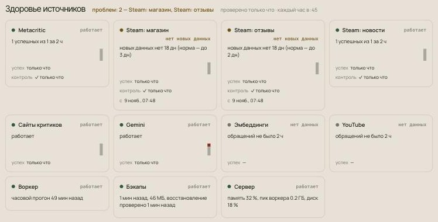
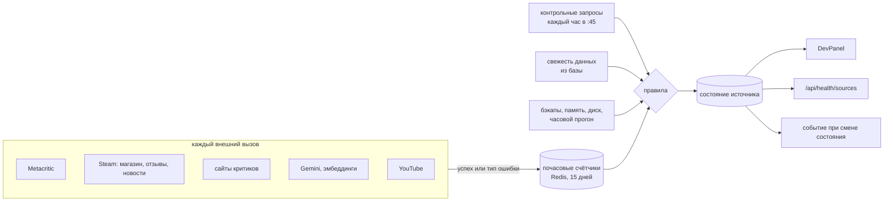

# Патч 9 ноября 2026: Steam, здоровье источников, похожие игры, бэкапы

Плановый разбор продакшена 9 ноября нашёл три критичных проблемы и одну тихую поломку данных, которая длилась
18 дней. Этот патч чинит всё найденное и добавляет то, чего не хватило, чтобы заметить поломку вовремя: наблюдение
за здоровьем каждого внешнего источника.

| Что было | Чем грозило | Что сделано |
|---|---|---|
| Отзывы Steam не собирались с 22 октября | профили новых игр почти пустые | переход на новый API Valve, сбор по частям, пауза при серии отказов |
| О поломке никто не узнал за 18 дней | любая следующая поломка тоже прошла бы молча | **новое:** здоровье источников в DevPanel и API |
| Пересчёт похожих игр рос как квадрат каталога | через ~2 недели воркер упал бы по памяти | расчёт блоками, в отдельном потоке |
| Бэкапов не было с 18 октября | потеря данных при сбое диска | ночной бэкап, недельная проверка восстановления, копия вне сервера |
| Слабая защита доступа к серверу | риск взлома | вход только по ключу, блокировка перебора, файрвол |
| Четыре карточки и одна суть падали каждый час | ~100 пустых ошибок в сутки прятали настоящие | карантин с растущей паузой |
| Один ключ Gemini отвечал 403 (найдено новым мониторингом) | каждый четвёртый вызов модели падал | ключ с 403 откладывается, вызов идёт следующему |

---

## Steam: что случилось и что изменилось

**Что случилось.** 22 октября Valve отключила адрес отзывов `store.steampowered.com/appreviews`. Теперь он отвечает
переадресацией на главную страницу магазина, одинаково для любого клиента и любой игры. Официальная замена —
[`IUserReviewsService/GetAppReviews`](https://partner.steamgames.com/doc/webapi/IUserReviewsService): те же поля,
параметры передаются в `input_json`, ключ не нужен.

**Почему ущерб оказался больше, чем один источник.** Сбор Steam шёл одной транзакцией: ссылка на игру, страница
магазина, отзывы, новости. Когда падали отзывы, откатывалось всё остальное, хотя магазин и новости работали. С 22
октября из Steam не сохранилось ни одного документа, ошибка стояла в 3 350 профилях.

**Почему заметили только через 18 дней.** HTTP-клиент шёл по переадресации и получал HTML главной страницы. Ошибка
подписывалась как «страница Cloudflare», хотя Cloudflare здесь ни при чём. Ошибки ловились по одной игре и нигде не
суммировались. Логи хранятся около пяти дней, так что начало поломки в них уже было не видно.

**Почему это важно.** Отзывы Steam — главный источник профиля игры: часы в игре и рекомендация. У игр с отзывами
Steam средняя наполненность профиля 55 %, без них — 6 %.

Что изменилось:

- **Новый API отзывов.** `filter: 1` (свежие), `purchase_type: 1` (все покупатели), `languages: ["all"]`, курсор
  по страницам. Разбор отзывов и выборка по часам в игре не изменились.
- **Части сохраняются по отдельности.** Ссылка, магазин, отзывы и новости коммитятся каждая сама по себе. Отказ одной
  больше не стирает остальные.
- **API не ходит по переадресациям.** Переадресация на JSON-адресе — это ошибка с адресом, куда отправили. Ответ не в
  JSON подписывается своим типом содержимого, без догадок.
- **Пауза после серии отказов.** Пять отказов подряд на одном адресе — пауза на час, одно событие в DevPanel, затем
  одна пробная попытка. Остальные адреса Steam при этом работают.

**Добор пропущенного.** 3 350 игр поставлены в очередь по приоритету: сначала 156 игр из топа и с оценками
(первые часы после выкатки), затем остальные. На время добора доля дневных токенов на профили поднята с 60 до 80 %.
Ожидаемый срок всего добора — 7–8 дней. Упор в токены модели, а не в Steam.

---

## Новое: здоровье источников

Каждый внешний источник теперь получает одно из состояний: **работает**, **с перебоями**, **нет новых данных**,
**квота на сегодня**, **не работает** или **нет данных**. Состояние видно в DevPanel и по API `/api/health/sources`.

  

Первая проверка после выкатки сразу пометила 18-дневную дыру в данных Steam.

Три сигнала на каждый источник:

- **Контрольный запрос.** Раз в час, в :45, приложение делает один дешёвый запрос к заведомо живому объекту и
  проверяет форму ответа: CS2 в Steam, известная игра на Metacritic. Этот сигнал ловит смену API, отключённый адрес
  или блокировку, даже если в этот час ни одной игре этот источник не понадобился.
- **Доля ошибок.** Каждый вызов записывает «успех» или тип ошибки в почасовой счётчик. Типы: переадресация, не JSON,
  4xx, 429, 5xx, сеть, неожиданная форма ответа, квота, пауза.
- **Свежесть.** Для каждого вида данных задан срок, дольше которого их отсутствие считается сбоем. Этот сигнал ловит
  тихую поломку: ни одной ошибки, но и ни одного нового документа.

<b>Правила по источникам</b>

 

| Источник | Контрольный запрос | «Не работает», если | «Нет новых данных», если |
|---|---|---|---|
| Metacritic | карточка известной игры | контроль не прошёл или 5+ вызовов без успеха | обновлений карточек нет 3 ч |
| Steam: отзывы | `GetAppReviews` для CS2, отзывы есть | то же | новых отзывов нет 48 ч, пока идут профили |
| Steam: магазин, новости | `appdetails` и `GetNewsForApp` для CS2 | то же | страниц магазина нет 72 ч |
| Сайты критиков | — (их сотни) | 20+ вызовов без успеха за сутки; «с перебоями» от 70 % ошибок | рецензий нет 96 ч |
| Gemini, эмбеддинги | — (тратит квоту) | 3+ вызова без успеха; дневной лимит — отдельное состояние «квота» | сводок нет 48 ч |
| YouTube | — | 3+ вызова без успеха | — |
| Воркер | — | часовой прогон не начинался 70 мин; проверка не запускалась 90 мин | — |
| Бэкапы | — | последнему бэкапу больше 26 ч | восстановление не проверялось 8 дней |
| Сервер | — | — | «с перебоями» при памяти > 85 % или диске > 80 % |

«С перебоями» для остальных источников — от 50 % ошибок при 10+ вызовах. Правила лежат в
[`backend/app/core/health.py`](../../../backend/app/core/health.py), сама проверка — в
[`backend/app/pipeline/healthcheck.py`](../../../backend/app/pipeline/healthcheck.py).

**Как это поймало бы Steam.** 22 октября около 23:45 контрольный запрос к отзывам CS2 получил бы переадресацию
вместо JSON. Источник перешёл бы в «не работает», в DevPanel плитка покраснела бы с текстом ошибки. Мы узнали бы
через час, а не через 18 дней.

**Первая находка — в первый же час.** Сразу после выкатки счётчики Gemini показали, что каждый четвёртый вызов
падает с `403 PERMISSION_DENIED`: Google закрыл бесплатный доступ для проекта одного из ключей. Раньше такой ключ
продолжал получать свою долю вызовов. Теперь ключ, ответивший 403, откладывается на 6 часов, вызов уходит
следующему ключу, а Gemini в DevPanel показывается «с перебоями» с названием ключа и причиной. Сам ключ нужно
проверить в Google AI Studio.

**Для внешнего пинга.** `/api/health` теперь проверяет Postgres и Redis и отвечает 503, если что-то из них недоступно.
Его можно отдавать сервису вроде UptimeRobot: он заметит то, о чём сервер сам не сообщит, например выключенный сервер.

---

## Похожие игры: память больше не растёт как квадрат каталога

Каждый час строились полные матрицы «каждая игра с каждой», семь штук, а Python перебирал все пары. Пока шёл
пересчёт, воркер больше ничего не делал. Теперь игры считаются блоками по 512, топ-8 для каждой игры выбирается
частичной сортировкой, расчёт идёт в отдельном потоке, а запись в базу — пакетами.

| Игр с векторами | Было: память | Было: время | Стало: память | Стало: время |
|---|---|---|---|---|
| 3 625 (сегодня) | 0,91 ГБ | 2,7 с | 0,44 ГБ | 0,6 с |
| 7 000 | 2,7 ГБ | 9,7 с | 0,66 ГБ | 1,8 с |
| 20 000 | ≈ 20 ГБ | минуты | 1,6 ГБ | 13 с |

Списки остались прежними. Старая реализация сохранена в тестах как эталон, и тест сравнивает с ней новую на
нескольких блоках.

---

## Бэкапы

- **Каждую ночь в 03:15 UTC** — дамп без сырых ответов Metacritic: таблица сохраняется, её строки нет. Сырые ответы
  занимают три четверти базы и скачиваются заново при следующем обновлении игры. Дамп весит 46 МБ вместо 201 МБ.
- **Хранение:** 14 ежедневных и 8 недельных копий, то есть два месяца истории.
- **Раз в неделю — проверка восстановления.** Свежий дамп разворачивается во временную базу рядом с рабочей, число игр
  сверяется с живой базой, временная база удаляется. Первая проверка: 4 290 игр из 4 290.
- **Копия вне сервера:** раз в сутки бэкапы копируются на рабочий компьютер.
- Возраст бэкапа и итог проверки видны в блоке здоровья.

Команды: `deploy/deploy.sh backup`, `install-timers`, `install-mac-pull`. Скрипты — [`deploy/backup.sh`](../../../deploy/backup.sh)
и [`deploy/restore-check.sh`](../../../deploy/restore-check.sh), таймеры — [`deploy/systemd`](../../../deploy/systemd).

---

## Защита сервера

Вход на сервер теперь только по ключу, перебор паролей блокируется автоматически, включён файрвол: открыты только
порты сайта и SSH. Добавлен файл подкачки на 2 ГБ, он страхует от нехватки памяти.

---

## Карантин повторяющихся ошибок

Раньше четыре карточки Metacritic без данных о продукте и одна игра, на которой модель отвечала пустым ответом,
падали каждый час. Это около 100 бессмысленных ошибок в сутки, которые прятали настоящие.

Теперь после трёх неудач подряд игра ждёт 1 час, потом 2, 4 и так далее, но не больше недели. Карточку, которая
трижды подряд пришла без продукта, приложение отправляет в архив. Один успех обнуляет счётчик.

---

## Как проверено

- **Модульные тесты:** 149 вместе с новыми:
  - правила и классификация ошибок;
  - новый API Steam: запрос, курсор, переадресация, не-JSON, пауза;
  - совпадение похожих игр с эталоном;
  - карантин;
  - ключ Gemini с ответом 403 откладывается, вызов берёт следующий ключ.
- **Интеграционные тесты на Postgres:** 13. Два новых: отказ отзывов Steam не стирает магазин, новости и ссылку;
  карантин и архив карточки.
- **Прод:** новые отзывы Steam снова сохраняются, первая проверка здоровья отработала, бэкап и проверка восстановления
  прошли, сайт и API отвечают 200.

## Что осталось

- **Ключ Gemini с ответом 403** нужно проверить в Google AI Studio: бесплатный доступ для его проекта закрыт. Пока
  он отложен, остальные ключи несут его долю, и дневной бюджет токенов соответственно меньше.
- **Оповещения** сейчас только в DevPanel. Telegram можно подключить отдельно, нужен бот.
- **Внешний пинг** `/api/health` готов, его нужно завести в UptimeRobot или похожем сервисе.
- **Пороги «нет новых данных»** выбраны по истории двух недель. После месяца наблюдений их стоит пересмотреть.
- **Долю токенов на профили** нужно вернуть к 60 % после добора.
