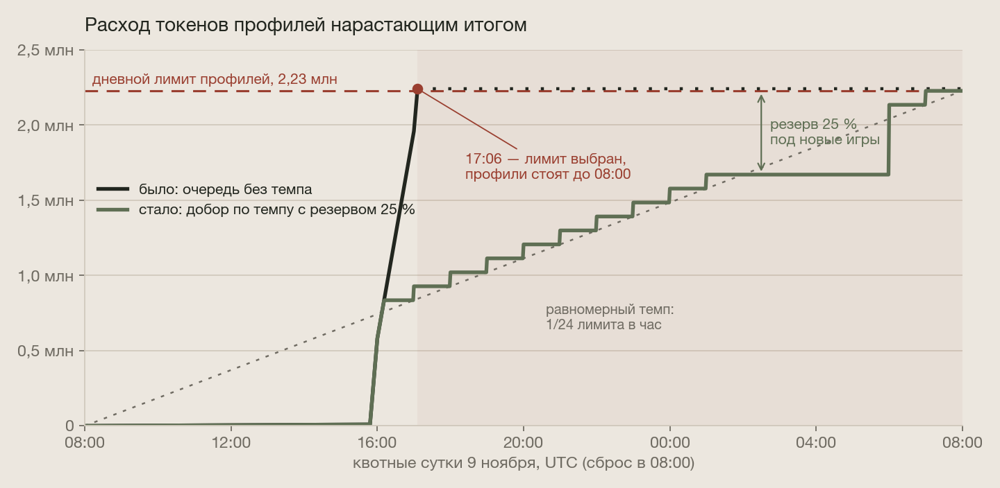
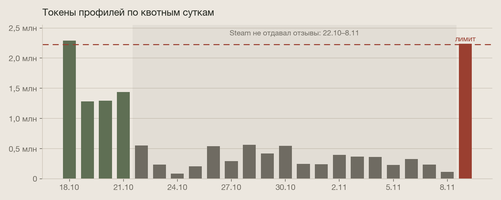
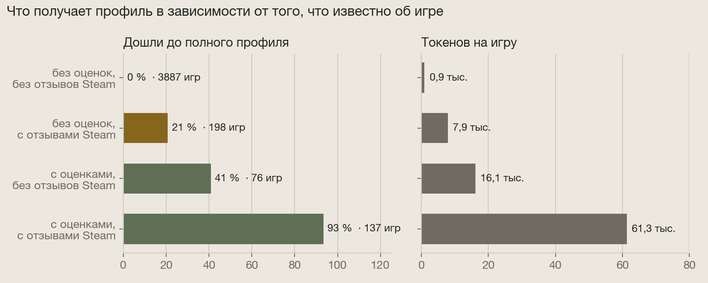
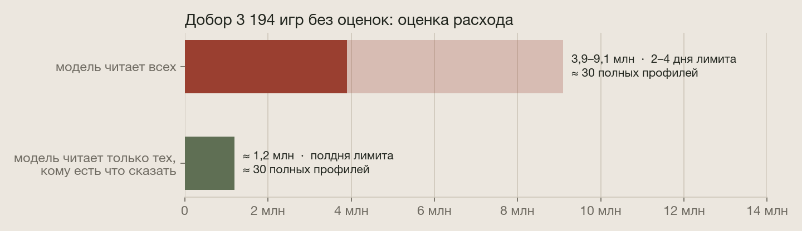

# Бюджет профилей: добор Steam и равномерный темп

Продолжение [патча 9 ноября](../README.md). После починки Steam в очередь на добор встали 3 350 игр. Добор
показал две проблемы в том, как профили тратят токены модели: дневной лимит выбирался за полтора часа, и токены
шли на игры, о которых модели нечего прочитать. Обе исправлены и выкачены в тот же вечер.

| Проблема | Что было видно | Решение |
|---|---|---|
| Новые игры ждут до утра | лимит профилей выбран к 17:06, следующие 15 часов профили не строились совсем | темп для обновлений и добора и резерв 25 % под новые игры |
| Токены на игры без данных | 3 887 игр без оценок и без отзывов Steam — ни одного полного профиля | модель читает игру только при оценках, месте в топе или 5+ отзывах Steam |

---

## Что случилось

  

Квотные сутки у Google начинаются в 08:00 UTC. Добор стартовал в 15:49 и потратил 2 240 787 токенов при лимите
профилей 2 227 200. В 16:00–17:00 ушло 1,38 млн — пятнадцать часовых норм за один час. В 17:06 проход остановился
и до 08:00 не строил профили ни новым играм, ни горячим, у которых пришли свежие отзывы.

Сводки отзывов и Deep analyze при этом работали: у них своя доля бюджета. Ключи модели не были исчерпаны, за
сутки ушло около 2,26 млн токенов из общего бюджета. Остановился только наш собственный предохранитель для
профилей. Он сработал правильно, но слишком поздно: внутри своей доли профили выбрали всё за час.

  

В обычные дни лимит не мешает: пока Steam работал, профили тратили 1,3–1,4 млн в сутки, без Steam — 0,1–0,6 млн.
Переполняет его волна: добор после починки источника, день крупных релизов, массовая пересборка профилей. Такие
волны будут и дальше, поэтому чинить нужно саму очередь, а не только этот добор.

### Как была устроена очередь

1. После каждого часового прогона запускается проход профилей — до 40 игр.
2. Порядок: новые игры (найдены за 3 дня, профиля нет), потом игры, чей срок подошёл, потом доля старого каталога.
3. Перед каждой игрой расход за квотные сутки сверяется с лимитом. Лимит выбран — проход останавливается, и все
   следующие тоже, до сброса.
4. Темпа не было: если очередь длинная, она тратит лимит так быстро, как обрабатываются игры.

Новые игры не терялись: они считаются новыми три дня и утром шли первыми. Но они ждали до 15 часов, а если бы
лимит выбрали рано утром — почти сутки. 9 ноября повезло: все 137 новых игр за сутки успели до остановки.

---

## Что получает профиль от разных игр

  

Данные — все 4 298 профилей в базе. Решает не только Metacritic: отзывы Steam бывают и у игр, которых критики не
заметили, и тогда профиль получается у каждой пятой. А игры без оценок и без отзывов Steam — это почти весь каталог
мелких релизов: 3 887 игр, средняя наполненность 4 %, ни одного полного профиля.

Добор 9 ноября это подтвердил:

- **130 игр с оценками:** в среднем 90 % наполненности и 17 тыс. токенов за проход, полный профиль у 119.
- **8 игр без оценок:** 11 % и 2,6 тыс. токенов, полный профиль у одной.

  

В очереди добора оставалось 3 194 игры без оценок. По истории отзывы Steam есть примерно у 5 % из них, около
155 игр, и из них полный профиль получит каждая пятая — около 30. Остальные 3 000 игр стоили бы 2,7–7,9 млн
токенов почти без результата. Нижняя граница — средняя по истории, верхняя — расход на игры без оценок 9 ноября,
когда к их данным добавились страница магазина и новости Steam. Это оценки, а не замеры.

---

## Решение 1: модель читает игру, только когда есть что читать

Сбор документов идёт у всех игр: Metacritic, магазин, отзывы и новости Steam, полные рецензии. Токенов он не
тратит. А модель разбирает документы игры, только если у неё есть хотя бы одно из трёх:

- оценки на Metacritic;
- место в топе New Releases;
- не меньше 5 отзывов Steam.

У остальных документы лежат непрочитанными. Когда у игры появятся оценки или отзывы, обычный проход разберёт всё
накопленное разом. Тихие игры обновляются раз в неделю, так что задержка — до недели. Поздние оценки получает
меньшинство: из 603 игр, найденных больше 20 дней назад без оценок, оценки появились у 76.

Почему порог 5 отзывов: при одном-двух отзывах профиль почти всегда остаётся пустым, а одна игра с отзывами
стоит модели около 8 тыс. токенов.

В карточке такой игры вкладка «Профиль» теперь говорит прямо: «Профиль появится, когда у игры будут отзывы:
оценки на Metacritic или отзывы игроков в Steam». Раньше там был пустой профиль, похожий на поломку.

Настройка: `GA_PROFILE_MIN_STEAM_REVIEWS` (по умолчанию 5). Код: `worth_reading` и `readable` в
[`backend/app/profile/pipeline.py`](../../../../backend/app/profile/pipeline.py).

## Решение 2: две полосы и равномерный темп

В проходе профилей теперь две полосы.

- **Без ограничений** — новые игры и игры из топа. Это то, что посетители видят первым. Они могут тратить весь
  дневной лимит.
- **По темпу** — обновления, добор и старый каталог. К часу *h* квотных суток они могут потратить не больше
  (*h* + 1) / 24 лимита. Счёт идёт нарастающим итогом, так что неистраченное в тихие часы переходит на следующие.
  Кроме того, эта полоса всегда оставляет 25 % лимита новым играм, а в последние два часа суток добирает остаток,
  чтобы он не сгорел.

| Час квотных суток | Полоса с темпом может потратить к этому часу |
|---|---|
| 0 (08:00 UTC) | 1/24 лимита, ≈ 4 % |
| 8 (16:00 UTC) | 9/24, ≈ 38 % |
| 17 (01:00 UTC) и дальше | 75 % — дальше держит резерв |
| 22 (06:00 UTC) | 23/24, ≈ 96 % |
| 23 (07:00 UTC) | весь лимит |

Расход за сутки тот же, но размазан на все 24 часа, и лимит больше не выбирается за час. Цена — волна идёт дольше
по времени: 156 игр с оценками заняли бы около суток вместо полутора часов. Среди игр, чей срок подошёл, первыми
идут игры из топа.

В DevPanel событие `profile.done` теперь показывает, сколько игр придержал темп (`held_by_pace`), сколько потрачено
(`spent`), сколько разрешено к этому часу (`pace`) и весь лимит (`cap`).

Настройка: `GA_PROFILE_PACE_RESERVE` (по умолчанию 0,25). Код: `pace_limit` в
[`backend/app/profile/pipeline.py`](../../../../backend/app/profile/pipeline.py), применение — `enrich_due` в
[`backend/app/pipeline/tasks.py`](../../../../backend/app/pipeline/tasks.py).

## Принцип: посетители не управляют расходом

Обсуждался ещё один сигнал — добирать в первую очередь игры, которые чаще открывают. Решили его не использовать.
Если интерес посетителей определяет, куда сервис тратит токены и запросы, любой может накрутить открытия и
направить бюджет туда, куда ему нужно. Поэтому приоритеты задают только данные об играх: оценки, отзывы, топ,
новизна. Функции, которые запускают сами посетители, как Deep analyze, получают свой небольшой фиксированный пул
с лимитами на пользователя и адрес и не трогают общий бюджет.

---

## Как проверено

- **Модульные тесты:** 157, из них новые:
  - кто стоит токенов: оценки, топ, 5 отзывов Steam, но не 4 и не 0;
  - темп: доля по часам, перенос тихих часов, резерв до последних двух часов.
- **Интеграционные тесты на Postgres:** 15, из них новые:
  - новые игры и топ свободны от темпа, топ идёт первым среди обновлений;
  - признак «есть что читать» считается по оценкам, топу и числу отзывов Steam.
- **Прод, сразу после выкатки:**
  - Проход профилей взял 40 игр. Темп придержал 38: к этому часу суток расход уже был выше разрешённого. Прошли
    2 игры из топа.
  - Карточка игры без оценок и без отзывов Steam показывает «профиль появится с отзывами». У игры с полным профилем
    всё по-прежнему.

## Что дальше

- В первые квотные сутки по новым правилам проверить по `profile.done`, что расход идёт ступенями и новые игры не
  ждут.
- После добора вернуть долю профилей в бюджете модели к прежней. На время добора её подняли.
- Порог в 5 отзывов и резерв в 25 % выбраны по истории двух недель. Через месяц их стоит пересмотреть по фактам.
