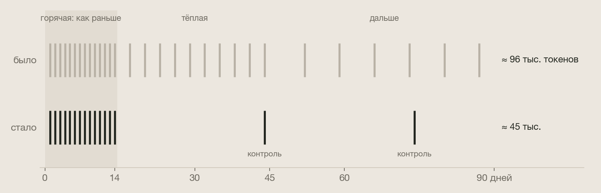
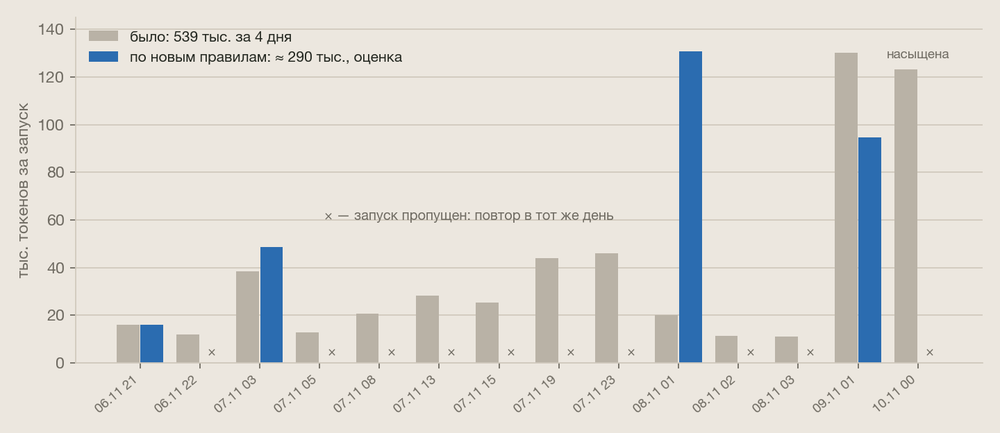
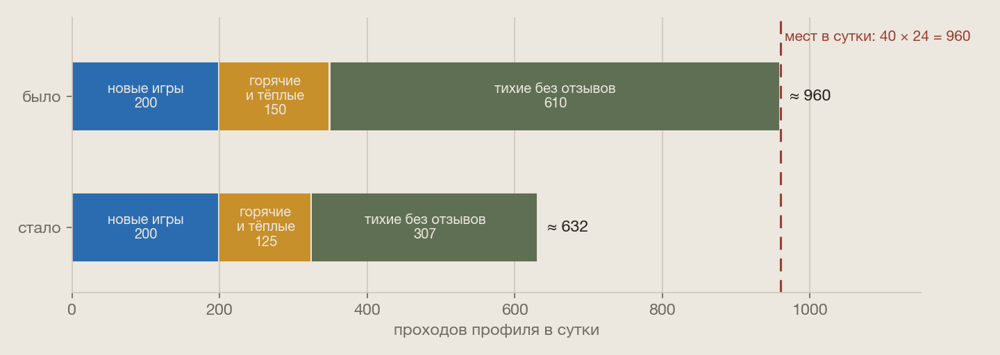

# Патч 10 ноября 2026: полные игры, сводки, очередь профилей

После патча [9 ноября](../2026-11-09/README.md) сервис сутки работал под нагрузкой, и мы разобрали, куда уходят
токены модели и места в очереди профилей. Нашлись три вещи:

- игры с уже полным профилем перечитываются так же часто, как пустые;
- одна ошибка заставляла пересчитывать готовые сводки каждый час;
- очередь профилей переполнена, а горячие игры ждут за тихими до 45 часов.

| Что было | Чем грозило | Что сделано |
|---|---|---|
| Полные профили перечитывались по обычному ритму | ~180 тыс. токенов в сутки на повторные проходы, и эта сумма росла бы с каталогом | **новое:** полная игра после первых двух недель проходит раз в 30 дней, всплеск отзывов будит её раньше |
| Сбой одной части анализа повторял готовые сводки каждый час | одна игра съела 539 тыс. токенов за 4 дня, 7 ноября её сводка прошла 7 раз | упавшая часть ждёт следующих суток, готовые не повторяются |
| Сводки игры с потоком отзывов пересчитывались каждый день | 125 тыс. токенов за запуск у одной игры | **новое:** насыщенная сводка (300+ текстов) ждёт, пока текстов станет больше наполовину |
| Выбранный лимит токенов останавливал прогон целиком | ночью 9→10 ноября пропало 12 прогонов, утром на обновления не было ни одного места | лимит придерживает только игры, которые модель будет читать, сбор идёт |
| Обновления шли только по сроку | горячие игры ждали за тихими до 45 ч | очередь по ярусу: топ, горячие, тёплые, остальные, тихие |
| Тихие игры без отзывов проходили раз в неделю | ~610 из 960 мест в сутки, и ни одна не стала пригодной для чтения на повторном проходе | раз в 14 дней |

---

## Полные игры: перечитывать только когда есть смысл

**Что такое «полная».** Полнота профиля считается без модели, по уже извлечённым фактам. По каждому из шести
факторов нужно 3 конкретных факта и подтверждение из 2 разных видов источников: игроки, критики, разработчик,
видео. Сверх этого фактор не растёт, у метрики есть потолок. Профиль с полнотой 80 и выше («богато») уже сказал о
каждом факторе достаточно. Новые отзывы того же рода его почти не меняют. Из 142 таких игр 105 стоят на 96–100.

**Что было.** Полная игра проходила по ритму своего яруса: горячая каждые 24 ч, тёплая каждые 72 ч, остальные раз в
неделю. Каждый проход заново собирал Steam, новости и рецензии, модель разбирала новые документы, а при росте фактов
на 20 % профиль пересобирался. За 21 день повторные проходы полных игр стоили 3,75 млн токенов.

**Что изменилось.** Полная игра после ближайшего прохода получает следующий только через 30 дней. Два исключения:

- **Горячие игры не замораживаются.** Это первые 14 дней после релиза и сутки после всплеска отзывов. В это время
  меняется восприятие: патчи, производительность, сдвиг оценок. Профиль, собранный на второй день, не должен
  держаться месяц. Сейчас горячие 65 полных игр из 142.
- **Всплеск будит.** Если на Metacritic за сутки прибавилось 10 % отзывов и не меньше 5, а до прохода профиля
  больше суток, проход переносится на сейчас.

  

Частота и цена проходов измерены на полных играх за 21 день:

| Возраст | Платных проходов в сутки | Цена прохода | Токенов в сутки на игру |
|---|---|---|---|
| 0–7 дней | 0,31 | 8,8 тыс. | 2,7 тыс. |
| 8–14 дней | 0,31 | 6,7 тыс. | 2,1 тыс. |
| 15–30 дней | 0,16 | 5,1 тыс. | 0,8 тыс. |

Платный проход — тот, в котором модели было что читать. После 30-го дня данных пока мало, потому что каталогу три
недели, там взята та же частота. На одну полную игру за 90 дней выходит около 96 тыс. токенов было и около 45 тыс.
стало.

Что не замораживается: оценки и число отзывов Metacritic в карточке по-прежнему обновляются каждый час. Замирают на
30 дней число отзывов Steam и новости в карточке полной игры, если не случится всплеска.

Настройки: `GA_PROFILE_SATURATED_FULLNESS` (80), `GA_PROFILE_SATURATED_DAYS` (30). Код: `saturated` и `next_pass` в
[`backend/app/profile/pipeline.py`](../../../backend/app/profile/pipeline.py), `wake_profile` в
[`backend/app/pipeline/ingest.py`](../../../backend/app/pipeline/ingest.py).

## Сводки отзывов: повторы и насыщение

Сводки и раньше обновлялись по приросту: модель получает прошлую сводку и только новые отзывы, до 300 штук. Дорогими
их делали две вещи.

**Повторы при сбое.** Отметка «проверено сегодня» ставилась, только если все части анализа прошли без ошибки:
критики, игроки и суть игры. Если одна падала, через час всё запускалось снова, и готовые части перечитывали новые
отзывы. Теперь отметка ставится, если хоть что-то записано. Упавшая часть ждёт следующих суток, а суть игры
пересобирается при следующем запуске, если она старше сводок. Если упало всё, повтор через час, как раньше.

**Насыщение.** Сводка, которая уже покрыла 300 текстов, ждёт, пока их станет больше наполовину. Критики и игроки
считаются отдельно, поэтому поток отзывов игроков не задерживает сводку критиков. Насыщенный вид пропускает запуск,
начатый другим.

  

Пример: The Legend of Zelda: Ocarina of Time получает около 400 новых отзывов игроков в сутки. 7 ноября её сводка
прошла 7 раз, потому что другая часть анализа падала. 10 ноября прошёл запуск на 123 тыс., хотя к 1 033 прочитанным
текстам прибавилось 374. По новым правилам — 4 запуска вместо 14, около 290 тыс. вместо 539 тыс. Отложенный запуск
сам читает накопившиеся отзывы, не больше 300, поэтому он дороже, чем был, — это учтено в оценке.

Настройки: `GA_ANALYSIS_SATURATED_TEXTS` (300), `GA_ANALYSIS_SATURATED_RATIO` (0,5). Код: `needs_analysis` в
[`backend/app/pipeline/tiers.py`](../../../backend/app/pipeline/tiers.py), `checked`, `covered_texts`,
`essence_stale` и `held` в [`backend/app/ai/lifecycle.py`](../../../backend/app/ai/lifecycle.py).

## Очередь профилей

Прогон профилей идёт раз в час и берёт до 40 игр: новые, потом те, чей срок прошёл, потом долю старого каталога.
10 ноября в 13:00 просрочены были 3 318 тихих игр (в среднем на 21 ч), 39 тёплых (34 ч) и 17 горячих (20 ч,
максимум 45 ч). Причин три.

**Лимит токенов останавливал всё.** Когда профили выбирали дневной лимит, прогон останавливался целиком, хотя
большинству игр в нём модель не нужна. 9 ноября лимит был выбран к 17:06, и с 19:00 до 08:00 не прошло ни одного
прогона. За ночь накопилось около 360 новых игр. Новые всегда идут первыми, поэтому до 13:00 на обновления не
досталось ни одного места.

Теперь игры, которые модель будет читать, при выбранном лимите или темпе ждут и не занимают место в прогоне. Прогон
берёт следующие и собирает их. Если игра после сбора стала пригодной для чтения, а токенов нет, она встаёт в очередь
сразу. В `profile.done` видно, сколько игр ждёт из-за лимита (`held_by_cap`) и из-за темпа (`held_by_pace`).

**Порядок только по сроку.** Внутри обновлений сначала шёл топ, потом всё по сроку. Тихая игра со вчерашним сроком
стояла впереди горячей со сроком сегодня. Теперь: топ, горячие, тёплые, остальные, тихие, а внутри яруса по сроку.

**Мест меньше, чем нужно.** 40 игр в час — это 960 в сутки. Нужно было около 1 000:

- новые ~200;
- горячие и тёплые ~150;
- тихие игры без отзывов ~610.

Тихие проходили раз в неделю, чтобы заметить, когда у них появятся отзывы Steam. Из 87 игр без оценок, набравших 5+
отзывов Steam, все набрали их на первом проходе и ни одна на повторном. Оговорка: с 22 октября по 9 ноября Steam не
отдавал отзывы, так что вывод предварительный. Теперь тихие игры, которым нечего читать, проходят раз в 14 дней. Игры
с 5+ отзывами Steam остаются на еженедельном ритме. Через 30 дней без отзывов тихие игры уходят в архив, как и раньше.

  

Спрос падает примерно до 630 проходов в сутки. Горячие и тёплые игры проходятся в ближайший час после срока.
Просроченная очередь, в основном добор после починки Steam, тает примерно на 300 игр в сутки и уйдёт за 10–11 дней.
Расход токенов это не меняет, запросов к Steam становится меньше.

Настройка: `GA_ENRICH_DORMANT_HOURS` (336). Код: `admit`, `TIER_ORDER` и `next_pass` в
[`backend/app/profile/pipeline.py`](../../../backend/app/profile/pipeline.py), `enrich_due` в
[`backend/app/pipeline/tasks.py`](../../../backend/app/pipeline/tasks.py).

---

## Эффект

| Что | Было в сутки | Станет | Откуда цифра |
|---|---|---|---|
| Сводки отзывов | 97 тыс. | ≈ 75 тыс. | все запуски за 14 дней через новые правила |
| Профили, сразу | — | ≈ −50 тыс. | 76 полных тёплых игр × 0,8 тыс. в сутки минус контрольные проходы |
| Профили, через 2–3 месяца | — | ≈ −150…300 тыс. | оценка: ~4,6 игры в сутки становятся полными, каждая экономит ~0,8 тыс. в сутки с 15-го по 90-й день |
| Проходы профиля | ~1 000 при 960 местах | ≈ 630 | расчёт по притоку новых игр и ритму ярусов |

Обычные сутки сейчас стоят около 874 тыс. токенов при безопасном бюджете 2,8 млн. Сразу набирается около 70 тыс. в
сутки, примерно 8 %. Главная часть приходит позже: без заморозки повторные проходы росли бы вместе с числом
повзрослевших полных игр.

## Что нашлось при проверке

Первая версия схемы была проще. До выкатки нашлись и исправлены три проблемы:

- **Молодые игры.** Заморожены были бы и они: 55 из 142 полных вышли меньше 14 дней назад, 16 из них в топе. Теперь
  горячие игры не замораживаются.
- **Сумма видов.** Насыщение считалось по сумме критиков и игроков. У Phantom Blade Zero 103 + 202 = 305, и 30 новых
  рецензий критиков ждали бы ещё 153 текста. Теперь каждый вид насыщается сам.
- **Лишние проходы от всплеска.** Всплеск переносил на «сейчас» любой будущий проход, даже тот, что и так через
  несколько часов. Теперь переносится только проход, до которого больше суток.

## Как проверено

- **Модульные тесты:** 174, из них 18 новых:
  - полнота и ритм, горячие не замораживаются, всплеск сохраняет обычный ритм;
  - насыщение сводок по видам, насыщенный вид пропускает чужой запуск;
  - упавшая часть не повторяет готовые, суть пересобирается, если старше сводок;
  - лимит придерживает чтение, но не сбор; тихие игры раз в 14 дней.
- **Интеграционные на Postgres:** 19, из них 4 новых:
  - всплеск будит только долгое ожидание;
  - покрытие считается по последней сводке каждого вида;
  - очередь по ярусу;
  - прогон целиком: при выбранном лимите читаемые игры ждут, а места уходят на сбор тихих; когда бюджет снова есть,
    первыми идут горячие.
- **Эффект** посчитан прогоном фактических запусков прода через новые правила: сводки за 14 дней, профили за 21 день.

## Что дальше

- В первые сутки после выкатки проверить по `profile.done` в DevPanel:
  - горячие и тёплые не ждут;
  - ночью прогоны идут при выбранном лимите;
  - очередь тает.
- Через месяц сверить оценку экономии по профилям с фактом: к тому времени полных игр старше двух недель станет
  больше.
- Порог 300 текстов и 30 дней контроля выбраны по двум неделям истории. Их стоит пересмотреть по фактам.
