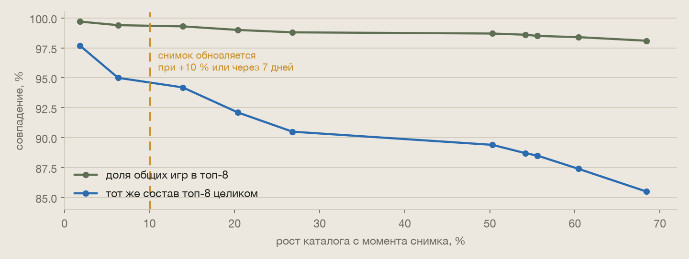
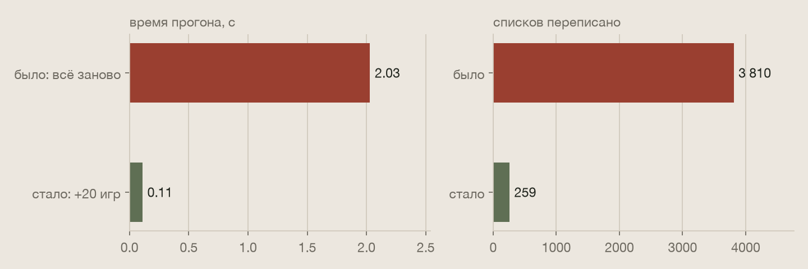

# Патч 10 ноября 2026: похожие игры без пересчёта всех пар

Списки похожих игр пересчитывались целиком после каждого часа, в котором появлялись новые векторы. Время и память
такого пересчёта растут с квадратом числа игр. При ~150 новинках в сутки к концу января он упёрся бы в память
сервера. Теперь новая игра стоит один проход по каталогу, а полный пересчёт идёт раз в неделю.

| Что было | Чем грозило | Что сделано |
|---|---|---|
| После каждого часа с новыми векторами пересчитывались все пары игр | время и память растут как N²: своп примерно с 12 тыс. игр, риск убийства процесса по памяти с 24 тыс. | **новое:** новая игра — один проход по каталогу, полный пересчёт — при обновлении снимка |
| Вместе с векторами загружалась вся строка: суть, ORM-объекты, около 86 КБ на игру | загрузка росла вместе с каталогом и занимала память до конца пересчёта | загружаются только векторы, теги и серия, и только для новых и изменённых игр |
| Каждый час таблица стиралась и заливалась заново, около 30 тыс. строк | лишняя запись: сотни тысяч строк в сутки при тех же списках | пишутся только списки, которые изменились |
| Центр и веса тегов пересчитывались каждый час | 40 новинок переставляли списки и у игр, к которым ни одна не подошла: 478 изменённых списков, из них 175 без новинки | центр и веса берутся из снимка каталога, снимок обновляется раз в неделю или при росте на 10 % |

---

## Почему пересчитывали всё

Оценка пары складывается из трёх сигналов: игровой процесс 0,5, теги 0,3, мир 0,2. Три величины в ней зависят от
всего каталога:

- **центр:** из векторов вычитается «средняя игра», иначе косинусы коротких текстов все около 0,8;
- **веса тегов:** редкий тег весит больше, редкость считается по каталогу;
- **среднее и разброс строки:** каждый сигнал приводится к одной шкале по сравнениям игры со всеми остальными.

Новинка чуть сдвигает все три. Поэтому прежний код пересчитывал все N² пар, хотя сырое сходство старых пар от неё
не меняется.

## Как теперь

**Снимок.** Центр и веса тегов фиксируются при полном пересчёте. С ними сходство каждой пары — постоянное число. Тег,
которого снимок не видел, весит как встреченный один раз.

**Среднее и разброс** каждой игры ведутся точно: сумма и сумма квадратов сходств. Новинка добавляет к ним по одному
слагаемому, удалённая игра вычитает своё. Среднее строки одинаково для всех кандидатов и порядок не меняет; порядок
зависит только от соотношения трёх разбросов.

**Буфер и граница.** Каждая игра хранит 32 лучших кандидата и границу: лучшую оценку за пределами буфера и веса, при
которых она получена. Новинка сравнивается с каждой старой игрой за один проход и входит в буферы, где прошла.
Вытесненный кандидат поднимает границу. Список берётся из буфера, только если восьмое место выше всего, что могло бы
набрать любая игра снаружи при сегодняшних весах. Иначе строка пересчитывается целиком, тоже за один проход.

**Изменённая игра** — новая суть, теги или серия — удаляется и добавляется заново. Игра, чья суть ждёт новых
векторов, уходит из всех списков, как и раньше.

**Полный пересчёт** идёт с новым снимком, если состояния нет (после перезапуска воркера или упавшего прогона),
прошло 7 дней, каталог вырос на 10 %, сменился порог похожести или за раз изменилась четверть каталога. Он считает
блоками, так что память растёт с каталогом линейно, и тоже пишет только изменившиеся списки.

Состояние живёт в памяти воркера: около 14 МБ на 24 тыс. игр без учёта векторов. Задача похожих игр идёт по одной
за раз. Если прогон упал, состояние сбрасывается, и следующий начнётся с полного пересчёта.

## Цена снимка

Повтор на векторах с прода: снимок от 31 октября (2 275 игр) против полного пересчёта с живыми весами по мере
роста каталога. При +10 % у 95 % игр тот же состав топ-8, общих игр в списках 99 %. Живой расчёт не точнее: он
зависит от того, какие игры пришли сегодня. Больше всего шумят веса тегов: тег, который был у одной игры и
появился у второй, резко теряет вес.

## Проверено

- **Точность.** Повтор десяти дней роста, от 2 275 до 3 830 игр с прода, по суткам, до 534 новинок за шаг:
  инкремент совпал с полным пересчётом с тем же снимком в 100 % списков. Целиком не пересчитывалась ни одна строка.
- **Тот же результат, что прежний код.** Полный пересчёт новым кодом на копии прода дал те же списки, что прежний:
  записано 0 изменений.
- **Время**, копия прода, одна машина:

| Прогон | Было | Стало |
|---|---|---|
| Полный пересчёт, 3 810 игр | 2,0 с | 1,5 с |
| Час с 20 новинками | 2,0 с, 3 810 списков | 0,11 с, 259 списков |
| Час без новинок | — | 0,02 с, 0 списков |

На проде прежний пересчёт занимал около 13 с: сервер медленнее этой машины в несколько раз. Час с новинками теперь
не зависит от числа пар, и в январе он останется долями секунды.

## Что теряем

- **Раз в неделю списки перестраиваются заметнее:** при обновлении снимка около 5 % составов меняются разом.
  Раньше они менялись каждый час понемногу.
- **Подпись «ближе всего»** в строках, которые не переписывались, считается по вчерашним среднему и разбросу. Она
  обновится при следующей записи строки или при новом снимке.
- **После перезапуска воркера** первый прогон — полный пересчёт, как раньше каждый час.

## Тесты

- Инкремент совпадает с полным пересчётом с тем же снимком: восемь шагов с новыми, удалёнными и изменёнными играми,
  с тегом, которого снимок не видел, и сменой серии.
- Буфер, из которого ушли все кандидаты, пересчитывается целиком и остаётся точным.
- Правила обновления снимка.
- На Postgres: первый прогон пишет всё, следующий — только новые игры и списки, куда они вошли; игра без
  свежих векторов уходит из всех списков; после перезапуска без изменений не переписывается ничего; упавший прогон
  сбрасывает состояние.

## Настройки

| Переменная | По умолчанию | Что задаёт |
|---|---|---|
| `GA_SIMILAR_SNAPSHOT_DAYS` | 7 | как часто обновляется снимок |
| `GA_SIMILAR_SNAPSHOT_GROWTH` | 0.10 | при каком росте каталога снимок обновляется раньше |
